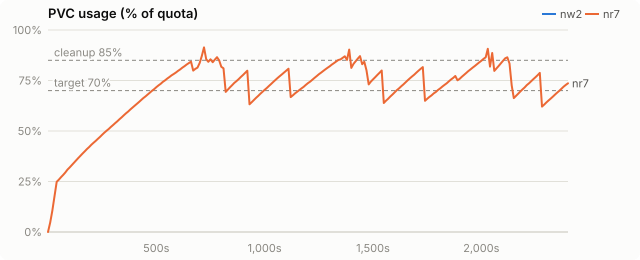
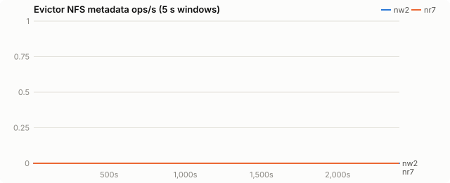
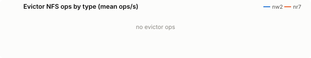
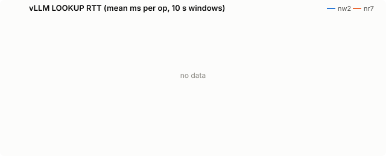
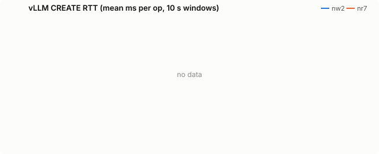
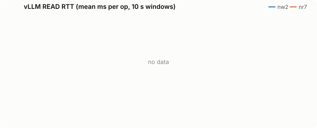

# kvreap on node-local NVMe, Qwen2.5-72B TP=4

Synthetic agent load (nyann-bench `conversation_pool`). The final numbers are on replayed Claude Code sessions: [final-nvme.md](final-nvme.md).

| run | evictor image |
|---|---|
| nw2 | `quay.io/wseaton/kvreap:r-0668381` |
| nr7 | `quay.io/wseaton/kvreap:r-db6a55b` |

The same 72B agentic load with the fs tier on the node's own NVMe (CoreWeave `/mnt/local`, an encrypted 8-drive RAID10, 27.9 TiB per H200 node) through a hostPath, for single-node deployments. kvreap runs on vLLM's node with `CAPACITY_BYTES` set to the 160 GiB budget, because statvfs on `/mnt/local` reports the whole node disk. **nw2** (kvreap plain LRU, `r-0668381`) ran on 2026-10-10; **nr7** (kvreap chain-aware, release candidate `r-db6a55b`) on 2026-10-11 with identical settings.

The Python `pvc_evictor` cannot run here. It sizes the disk only through statvfs, so on this hostPath it reads the node's 27.9 TiB and never reaches its cleanup threshold; `hostpath-proof/` runs its own usage function after overfilling a 16 GiB budget by 25%.

## Findings

| | nw2: kvreap plain LRU | nr7: kvreap chain-aware | nr7 vs nw2 |
|---|---|---|---|
| requests completed in 40 min | 2,656 | **3,459** | +30% |
| prefix tokens served from offload tiers | 35.6M of 46.4M | **56.9M of 60.3M** | +60% |
| returning-turn TTFT p90 | 2,390 ms | **1,704 ms** | −29% |
| returning-turn TTFT p99 | 5,966 ms | **2,646 ms** | 2.3× lower |
| KV rewritten to NVMe | 1.79 TB | **0.58 TB** | −67% |
| deletions that cut a live chain (internal) | 82,501 | **33** | |
| vLLM load failures | 29 | **0** | |
| max usage of the 160 GiB budget | 102.1% | **91.4%** | |

- **NVMe cuts tail latency for both policies** compared with VAST, and chain-aware eviction keeps its lead.
- **The budget holds.** With `CAPACITY_BYTES`, usage is estimated from bucket samples. Earlier builds listed buckets every 60 s and sampled one a second, and the estimate trailed the disk: the true footprint reached 110.9% of the budget. The release candidate lists every 5 s and samples ten a second; usage peaked at 91.4%.

## Setup

| setting | value |
|---|---|
| model | Qwen/Qwen2.5-72B-Instruct |
| vLLM image | docker.io/vllm/vllm-openai:v0.31.0 |
| PVC size | 160Gi |
| storage class | kvreap-bench-vast |
| load duration (s) | 2400 |
| offload block (tokens) | 16 |
| CPU tier (bytes) | 34359738368 |
| GPU KV blocks | 16384 |
| churn prompt length | 4096 |
| churn concurrency | 8 |
| hot prefixes | 64 |
| hot prefix length | 2048 |
| hot request rate (req/s) | 2.0 |

Time axes are seconds since the load generator started.

## PVC usage

<picture><source media="(prefers-color-scheme: dark)" srcset="agent-pool-nvme/charts/usage-dark.svg"></picture>

## Evictor metadata load

<picture><source media="(prefers-color-scheme: dark)" srcset="agent-pool-nvme/charts/evictor-ops-dark.svg"></picture>

## Evictor ops by type

<picture><source media="(prefers-color-scheme: dark)" srcset="agent-pool-nvme/charts/evictor-op-types-dark.svg"></picture>

## vLLM LOOKUP latency

<picture><source media="(prefers-color-scheme: dark)" srcset="agent-pool-nvme/charts/rtt-lookup-dark.svg"></picture>

## vLLM CREATE latency

<picture><source media="(prefers-color-scheme: dark)" srcset="agent-pool-nvme/charts/rtt-create-dark.svg"></picture>

## vLLM WRITE latency

<picture><source media="(prefers-color-scheme: dark)" srcset="agent-pool-nvme/charts/rtt-write-dark.svg"></picture>

## vLLM READ latency

<picture><source media="(prefers-color-scheme: dark)" srcset="agent-pool-nvme/charts/rtt-read-dark.svg"></picture>

## Hot-prefix TTFT

<picture><source media="(prefers-color-scheme: dark)" srcset="agent-pool-nvme/charts/ttft-dark.svg"></picture>

## All metrics

| metric | nw2 | nr7 |
|---|---|---|
| load duration (s) | 2,405 | 2,403 |
| **evictor metadata ops/s (mean)** | 0.0 | 0.0 |
| evictor metadata ops (total) | 0 | 0 |
| vLLM LOOKUP RTT ms (all) | - | - |
| vLLM LOOKUP RTT ms (deleting / idle) | - / - | - / - |
| vLLM GETATTR RTT ms (all) | - | - |
| vLLM GETATTR RTT ms (deleting / idle) | - / - | - / - |
| vLLM CREATE RTT ms (all) | - | - |
| vLLM CREATE RTT ms (deleting / idle) | - / - | - / - |
| vLLM RENAME RTT ms (all) | - | - |
| vLLM RENAME RTT ms (deleting / idle) | - / - | - / - |
| vLLM WRITE RTT ms (all) | - | - |
| vLLM WRITE RTT ms (deleting / idle) | - / - | - / - |
| vLLM READ RTT ms (all) | - | - |
| vLLM READ RTT ms (deleting / idle) | - / - | - / - |
| vLLM LOOKUP client queue ms | - | - |
| vLLM GETATTR client queue ms | - | - |
| vLLM CREATE client queue ms | - | - |
| vLLM RENAME client queue ms | - | - |
| vLLM WRITE client queue ms | - | - |
| vLLM READ client queue ms | - | - |
| vLLM FS read s/GiB | 9.39 | 9.25 |
| vLLM FS write s/GiB | 2.10 | 7.45 |
| vLLM metadata ops/s | 0 | 0 |
| prune cycles | 16 | 9 |
| prune seconds (median) | 10.3 | 5.0 |
| max usage % | 102.1 | 91.4 |
| % time >= cleanup threshold | 14.6 | 8.3 |
| hot ttft p50 ms | - | - |
| hot ttft p90 ms | - | - |
| hot ttft p99 ms | - | - |
| agent requests | 2,656 | 3,459 |
| agent failed | 0 | 0 |
| agent first ttft p50 ms | 1,092.2 | 1,197.2 |
| agent first ttft p90 ms | 3,395.4 | 2,750.5 |
| agent later ttft p50 ms | 1,072.2 | 1,066.1 |
| agent later ttft p90 ms | 2,389.8 | 1,704.4 |
| agent later ttft p99 ms | 5,965.5 | 2,646.3 |
| agent prompt tok per s | - | - |
| hot requests (failed) | - (-) | - (-) |
| churn input tok/s | - | - |
| vLLM log: quota_exceeded | 0 | 0 |
| vLLM log: store_failed | 0 | 0 |
| vLLM log: load_failed | 29 | 0 |
| chain deletions: heads (root + orphan) | 56,487 | - |
| chain deletions: root | 147 | 0 |
| chain deletions: orphan (parent gone) | 56,340 | 37 |
| chain deletions: internal | 82,501 | 33 |
| chain deletions: leaf | 23,467 | 166,121 |
| chain deletions: untracked | 0 | 0 |
| chain deferrals | 0 | - |
| chain deletions: cascaded below a deleted root | 0 | 166,053 |
| blocks announced without a digest | 0 | 0 |
| leaf edges skipped as too young | 0 | 93,528 |
| young leaf edges deleted under pressure | 0 | - |
| young leaf edges deleted in the emergency band | - | - |
| KV event batches received | 35,319 | 45,036 |
| KV event decode errors | 0 | 0 |
| `vllm:external_prefix_cache_hits_total{engine="0",model_name="Qwen/Qwen2.5-72B-Instruct"}` Δ | 35,596,608 | 56,857,232 |
| `vllm:external_prefix_cache_queries_total{engine="0",model_name="Qwen/Qwen2.5-72B-Instruct"}` Δ | 46,391,015 | 60,304,627 |
| `vllm:kv_offload_load_bytes_total{engine="0",model_name="Qwen/Qwen2.5-72B-Instruct"}` Δ | 5,832,148,254,720 | 9,315,488,890,880 |
| `vllm:kv_offload_load_time_total{engine="0",model_name="Qwen/Qwen2.5-72B-Instruct"}` Δ | 194 | 326 |
| `vllm:kv_offload_store_bytes_total{engine="0",model_name="Qwen/Qwen2.5-72B-Instruct"}` Δ | 1,790,868,193,280 | 582,895,534,080 |
| `vllm:kv_offload_store_time_total{engine="0",model_name="Qwen/Qwen2.5-72B-Instruct"}` Δ | 74 | 31 |
| `vllm:kv_offload_tiering_chunk_hits_total{engine="0",model_name="Qwen/Qwen2.5-72B-Instruct",tier="1:StripedFileSystemTierManager"}` Δ | 2,232,150 | 3,556,071 |
| `vllm:kv_offload_tiering_chunk_queries_total{engine="0",model_name="Qwen/Qwen2.5-72B-Instruct",tier="0:primary"}` Δ | 2,898,165 | 3,769,954 |
| `vllm:kv_offload_tiering_chunk_queries_total{engine="0",model_name="Qwen/Qwen2.5-72B-Instruct",tier="1:StripedFileSystemTierManager"}` Δ | 2,234,812 | 3,559,537 |
| `vllm:kv_offload_tiering_promotion_job_failures_total{engine="0",model_name="Qwen/Qwen2.5-72B-Instruct",tier="1:StripedFileSystemTierManager"}` Δ | 16 | - |
| `vllm:kv_offload_tiering_read_bytes_total{engine="0",model_name="Qwen/Qwen2.5-72B-Instruct",tier="1:StripedFileSystemTierManager"}` Δ | 5,832,148,254,720 | 9,322,026,762,240 |
| `vllm:kv_offload_tiering_read_time_total{engine="0",model_name="Qwen/Qwen2.5-72B-Instruct",tier="1:StripedFileSystemTierManager"}` Δ | 50,998 | 80,323 |
| `vllm:kv_offload_tiering_write_bytes_total{engine="0",model_name="Qwen/Qwen2.5-72B-Instruct",tier="1:StripedFileSystemTierManager"}` Δ | 1,790,868,193,280 | 582,895,534,080 |
| `vllm:kv_offload_tiering_write_time_total{engine="0",model_name="Qwen/Qwen2.5-72B-Instruct",tier="1:StripedFileSystemTierManager"}` Δ | 3,501 | 4,042 |
| `vllm:kv_offload_total_bytes_total{engine="0",model_name="Qwen/Qwen2.5-72B-Instruct",transfer_type="CPU_to_GPU"}` Δ | 5,832,148,254,720 | 9,315,488,890,880 |
| `vllm:kv_offload_total_bytes_total{engine="0",model_name="Qwen/Qwen2.5-72B-Instruct",transfer_type="GPU_to_CPU"}` Δ | 1,790,868,193,280 | 582,895,534,080 |
| `vllm:kv_offload_total_time_total{engine="0",model_name="Qwen/Qwen2.5-72B-Instruct",transfer_type="CPU_to_GPU"}` Δ | 194 | 326 |
| `vllm:kv_offload_total_time_total{engine="0",model_name="Qwen/Qwen2.5-72B-Instruct",transfer_type="GPU_to_CPU"}` Δ | 74 | 31 |
| `vllm:prefix_cache_hits_total{engine="0",model_name="Qwen/Qwen2.5-72B-Instruct"}` Δ | 4,316,352 | 5,566,560 |
| `vllm:prefix_cache_queries_total{engine="0",model_name="Qwen/Qwen2.5-72B-Instruct"}` Δ | 50,707,367 | 65,871,187 |
