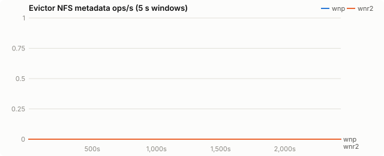
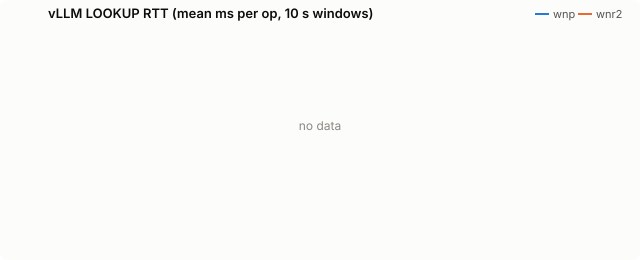
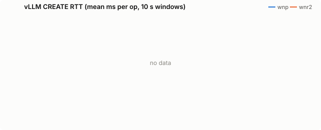
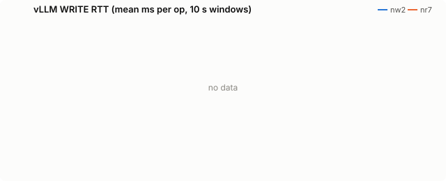
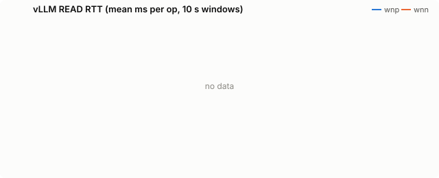
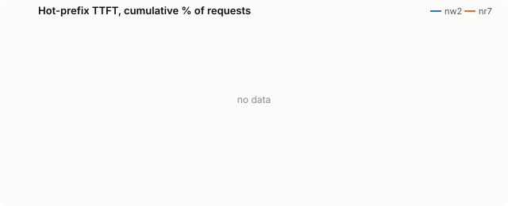

# Final: kvreap on node-local NVMe, replayed Claude Code sessions, Qwen2.5-72B TP=4

| run | evictor image |
|---|---|
| wnp | `quay.io/wseaton/kvreap:r-37c777a` |
| wnr2 | `quay.io/wseaton/kvreap:r-75c1b4a` |

The same replayed Claude Code sessions as [final-vast.md](final-vast.md) with the fs tier on the node's own NVMe (CoreWeave `/mnt/local`, an encrypted 8-drive RAID10) through a hostPath, budget 160 GiB via `CAPACITY_BYTES`, for single-node deployments. kvreap runs on vLLM's node.

| run | evictor | load start (UTC) |
|---|---|---|
| wnp | kvreap plain LRU (`KV_EVENTS_ENDPOINTS` empty), `r-37c777a` | 2026-10-12 03:15 |
| wnr2 | kvreap chain-aware, `r-75c1b4a` | 2026-10-12 06:38 |

The Python `pvc_evictor` cannot run here: it sizes the disk with statvfs, which reports the whole node RAID, so it never reaches its threshold (`hostpath-proof/`).

## Findings

| | wnp: plain LRU | wnr2: chain-aware | wnr2 vs wnp |
|---|---|---|---|
| requests completed in 40 min | 643 | **742** | +15% |
| prompt tokens served from the fs tier | 4.4M of 17.0M | **9.9M of 20.7M** | 2.3× |
| later main-agent TTFT p50 | 4.7 s | **3.6 s** | −23% |
| later main-agent TTFT p90 / p99 | **30.5 / 71.1 s** | 45.2 / 89.8 s | worse |
| failed fs reads | **218** | 1,648 | |
| deletions that cut a live chain (internal) | not tracked | 503 | |
| KV written to NVMe | 3.41 TB | **3.14 TB** | −8% |
| max usage of the budget | 85.2% | 95.0% | |

- **Same shape as VAST at 160 GiB.** More requests and twice the prefix tokens from disk, a lower median, worse tails from a longer queue, and more failed reads because the live sessions do not fit in 160 GiB and chain-aware cuts the least recently used ones.
- **Usage runs higher.** Chain-aware holds back recently used sessions below the 91% line while the sampler looks for finished ones, and peaked at 95.0% of the budget; `CAPACITY_BYTES` is counted from the chain index, so the budget held.

## Workload (as final-vast.md)

Replayed Claude Code sessions from the SemiAnalysis Weka trace corpus (`semianalysisai/cc-traces-weka-062126-256k`, revision `8fecd2f`: 393 sessions, 68,266 model requests, subagents included) with NVIDIA AIPerf 0.13.0, image `quay.io/wseaton/kvbench-aiperf:0.13.0-w062126` built from `bench/aiperf-image/`. Each trace records, per request, the input length, output length, think time and the request's 64-token KV block hashes. AIPerf rebuilds every prompt from those hashes and replays the session's recorded history (not the live responses), so every run sends the same token sequences and the prefix sharing of the real sessions, inside a session and between a session and its subagents, is reproduced exactly. Traces share nothing with each other.

| choice | value | why |
|---|---|---|
| model | Qwen2.5-72B-Instruct, TP=4, fp8 KV, YaRN ×4 to 131,072 tokens | same model and KV size (164 KB/token) as the earlier 72B runs; Claude Code contexts run past 100k tokens. vLLM 0.31 needs `max_position_embeddings` raised in `--hf-overrides` as well as `rope_parameters`. |
| corpus | the 256k-capped variant | the full-context corpus has requests up to 1M tokens |
| dropped requests | input over 120,000 tokens | leaves room in 131,072 for the output and for AIPerf's rebuilt history, which can run several percent past the recorded input length. This drops 36% of the corpus's requests: 58% of main-agent turns (Claude Code's main context usually runs past 120k before it compacts) and 21% of subagent requests. A main session replays until its context passes 120k tokens, then skips to its next compaction and continues from there. |
| sessions in flight | 6 | AIPerf concurrency mode: 6 traces at a time, each with its subagents; a finished trace is replaced by the next one in corpus order (96 loaded, about 20 started per run) |
| think time | the recorded per-request think time, capped at 60 s | keeps the gaps between tool calls and the user's short pauses; drops the hour-long breaks |
| output | the recorded length, `ignore_eos`, temperature 0; main-agent outputs capped at 1,024 tokens | identical decode work in every run |
| GPU KV cache | 40,960 blocks (655k tokens) | 6 sessions plus their subagents keep 0.8-1.4M tokens of context live (requests within the last 90 s), more than the GPU holds |
| CPU tier | 32 GiB (210k tokens) | as before |
| fs tier | 160 GiB (1.05M tokens) and 320 GiB (2.1M tokens) | 160 GiB is about the live working set, so every evictor has to cut live sessions; 320 GiB also holds the finished sessions and subagent chains |

Pilots (not reported): 16 sessions queued requests for minutes (TTFT p50 20 s); 8 with a 1M-token GPU cache kept more context live than the fs tier holds and the evictor rewrote live prefixes at 2.6 GB/s; 4 sessions barely touched the fs tier.

## Setup

| setting | value |
|---|---|
| model | Qwen/Qwen2.5-72B-Instruct |
| vLLM image | docker.io/vllm/vllm-openai:v0.31.0 |
| max model length | 131072 |
| HF config overrides | {'max_position_embeddings': 131072, 'rope_parameters': {'rope_type': 'yarn', 'factor': 4.0, 'original_max_position_embeddings': 32768, 'rope_theta': 1000000.0}} |
| cache size (PVC, or budget on the host path) | 160Gi |
| cache host path | /mnt/local/kvreap-bench |
| storage class | kvreap-bench-vast |
| load duration (s) | 2400 |
| offload block (tokens) | 16 |
| CPU tier (bytes) | 34359738368 |
| GPU KV blocks | 40960 |
| workload | weka |
| AIPerf image | quay.io/wseaton/kvbench-aiperf:0.13.0-w062126 |
| Weka dataset | semianalysis_cc_traces_weka_062126_256k |
| traces loaded | 96 |
| concurrent sessions | 6 |
| max input tokens (longer requests dropped) | 120000 |
| max output tokens (root sessions) | 1024 |
| think-time cap (s) | 60.0 |
| random seed | 42 |

Time axes are seconds since the load generator started.

## PVC usage

<picture><source media="(prefers-color-scheme: dark)" srcset="final-nvme/charts/usage-dark.svg"></picture>

## Evictor metadata load

<picture><source media="(prefers-color-scheme: dark)" srcset="final-nvme/charts/evictor-ops-dark.svg"></picture>

## Evictor ops by type

<picture><source media="(prefers-color-scheme: dark)" srcset="final-nvme/charts/evictor-op-types-dark.svg"></picture>

## vLLM LOOKUP latency

<picture><source media="(prefers-color-scheme: dark)" srcset="final-nvme/charts/rtt-lookup-dark.svg"></picture>

## vLLM CREATE latency

<picture><source media="(prefers-color-scheme: dark)" srcset="final-nvme/charts/rtt-create-dark.svg"></picture>

## vLLM WRITE latency

<picture><source media="(prefers-color-scheme: dark)" srcset="final-nvme/charts/rtt-write-dark.svg"></picture>

## vLLM READ latency

<picture><source media="(prefers-color-scheme: dark)" srcset="final-nvme/charts/rtt-read-dark.svg"></picture>

## TTFT of requests that can reuse a prefix

<picture><source media="(prefers-color-scheme: dark)" srcset="final-nvme/charts/ttft-dark.svg"></picture>

## All metrics

| metric | wnp | wnr2 |
|---|---|---|
| load duration (s) | 2,436 | 2,438 |
| **evictor metadata ops/s (mean)** | 0.0 | 0.0 |
| evictor metadata ops (total) | 0 | 0 |
| vLLM LOOKUP RTT ms (all) | - | - |
| vLLM LOOKUP RTT ms (deleting / idle) | - / - | - / - |
| vLLM GETATTR RTT ms (all) | - | - |
| vLLM GETATTR RTT ms (deleting / idle) | - / - | - / - |
| vLLM CREATE RTT ms (all) | - | - |
| vLLM CREATE RTT ms (deleting / idle) | - / - | - / - |
| vLLM RENAME RTT ms (all) | - | - |
| vLLM RENAME RTT ms (deleting / idle) | - / - | - / - |
| vLLM WRITE RTT ms (all) | - | - |
| vLLM WRITE RTT ms (deleting / idle) | - / - | - / - |
| vLLM READ RTT ms (all) | - | - |
| vLLM READ RTT ms (deleting / idle) | - / - | - / - |
| vLLM LOOKUP client queue ms | - | - |
| vLLM GETATTR client queue ms | - | - |
| vLLM CREATE client queue ms | - | - |
| vLLM RENAME client queue ms | - | - |
| vLLM WRITE client queue ms | - | - |
| vLLM READ client queue ms | - | - |
| vLLM FS read s/GiB | 10.78 | 11.49 |
| vLLM FS write s/GiB | 2.30 | 3.52 |
| vLLM metadata ops/s | 0 | 0 |
| prune cycles | 33 | 17 |
| prune seconds (median) | 18.0 | 28.5 |
| max usage % | 85.2 | 95.0 |
| % time >= cleanup threshold | 0.8 | 16.0 |
| hot ttft p50 ms | - | - |
| hot ttft p90 ms | - | - |
| hot ttft p99 ms | - | - |
| weka requests | 643 | 742 |
| weka failed | 21 | 39 |
| weka cancelled | 0 | 0 |
| weka sessions | 19 | 21 |
| weka ttft p50 ms | 3,578.3 | 4,152.6 |
| weka ttft p90 ms | 47,839.5 | 61,336.5 |
| weka ttft p99 ms | 88,503.8 | 90,677.1 |
| weka first ttft p50 ms | 3,948.4 | 3,983.2 |
| weka first ttft p90 ms | 19,451.4 | 40,514.9 |
| weka later ttft p50 ms | 4,731.1 | 3,647.6 |
| weka later ttft p90 ms | 30,505.7 | 45,191.5 |
| weka later ttft p99 ms | 71,126.1 | 89,824.8 |
| weka subagent ttft p50 ms | 2,948.5 | 4,291.2 |
| weka subagent ttft p90 ms | 52,331.9 | 65,569.6 |
| weka subagent ttft p99 ms | 92,451.9 | 90,698.3 |
| weka prompt tok per s | 15,349.0 | 17,559.0 |
| weka output tok per s | 138.8 | 159.1 |
| hot requests (failed) | - (-) | - (-) |
| churn input tok/s | - | - |
| vLLM log: quota_exceeded | 0 | 0 |
| vLLM log: store_failed | 0 | 0 |
| vLLM log: load_failed | 218 | 1,648 |
| chain deletions: heads (root + orphan) | - | - |
| chain deletions: root | - | 27 |
| chain deletions: orphan (parent gone) | - | 180,085 |
| chain deletions: internal | - | 503 |
| chain deletions: leaf | - | 359,041 |
| chain deletions: untracked | - | 471 |
| chain deferrals | - | - |
| chain deletions: cascaded below a deleted root | - | 539,018 |
| blocks announced without a digest | - | 0 |
| leaf edges skipped as too young | - | 177,653 |
| young leaf edges deleted under pressure | - | - |
| young leaf edges deleted in the emergency band | - | - |
| KV event batches received | - | 22,188 |
| KV event decode errors | - | 0 |
| `vllm:external_prefix_cache_hits_total{engine="0",model_name="Qwen/Qwen2.5-72B-Instruct"}` Δ | 4,353,472 | 9,871,344 |
| `vllm:external_prefix_cache_queries_total{engine="0",model_name="Qwen/Qwen2.5-72B-Instruct"}` Δ | 17,030,284 | 20,685,194 |
| `vllm:kv_offload_allocation_failure_total{engine="0",model_name="Qwen/Qwen2.5-72B-Instruct"}` Δ | 77 | 189 |
| `vllm:kv_offload_load_bytes_total{engine="0",model_name="Qwen/Qwen2.5-72B-Instruct"}` Δ | 719,399,157,760 | 1,651,499,335,680 |
| `vllm:kv_offload_load_time_total{engine="0",model_name="Qwen/Qwen2.5-72B-Instruct"}` Δ | 22 | 53 |
| `vllm:kv_offload_store_bytes_total{engine="0",model_name="Qwen/Qwen2.5-72B-Instruct"}` Δ | 3,406,320,107,520 | 3,135,577,784,320 |
| `vllm:kv_offload_store_time_total{engine="0",model_name="Qwen/Qwen2.5-72B-Instruct"}` Δ | 153 | 179 |
| `vllm:kv_offload_tiering_chunk_hits_total{engine="0",model_name="Qwen/Qwen2.5-72B-Instruct",tier="0:primary"}` Δ | 155,068 | 139,002 |
| `vllm:kv_offload_tiering_chunk_hits_total{engine="0",model_name="Qwen/Qwen2.5-72B-Instruct",tier="1:StripedFileSystemTierManager"}` Δ | 219,249 | 623,066 |
| `vllm:kv_offload_tiering_chunk_queries_total{engine="0",model_name="Qwen/Qwen2.5-72B-Instruct",tier="0:primary"}` Δ | 1,108,696 | 1,362,888 |
| `vllm:kv_offload_tiering_chunk_queries_total{engine="0",model_name="Qwen/Qwen2.5-72B-Instruct",tier="1:StripedFileSystemTierManager"}` Δ | 220,479 | 623,877 |
| `vllm:kv_offload_tiering_promotion_allocation_failures_total{engine="0",model_name="Qwen/Qwen2.5-72B-Instruct"}` Δ | 5 | 557 |
| `vllm:kv_offload_tiering_promotion_job_failures_total{engine="0",model_name="Qwen/Qwen2.5-72B-Instruct",tier="1:StripedFileSystemTierManager"}` Δ | 21 | 39 |
| `vllm:kv_offload_tiering_read_bytes_total{engine="0",model_name="Qwen/Qwen2.5-72B-Instruct",tier="1:StripedFileSystemTierManager"}` Δ | 575,267,143,680 | 1,928,373,207,040 |
| `vllm:kv_offload_tiering_read_time_total{engine="0",model_name="Qwen/Qwen2.5-72B-Instruct",tier="1:StripedFileSystemTierManager"}` Δ | 5,774 | 20,631 |
| `vllm:kv_offload_tiering_write_bytes_total{engine="0",model_name="Qwen/Qwen2.5-72B-Instruct",tier="1:StripedFileSystemTierManager"}` Δ | 3,409,001,840,640 | 3,138,259,517,440 |
| `vllm:kv_offload_tiering_write_time_total{engine="0",model_name="Qwen/Qwen2.5-72B-Instruct",tier="1:StripedFileSystemTierManager"}` Δ | 7,313 | 10,300 |
| `vllm:kv_offload_total_bytes_total{engine="0",model_name="Qwen/Qwen2.5-72B-Instruct",transfer_type="CPU_to_GPU"}` Δ | 719,399,157,760 | 1,651,499,335,680 |
| `vllm:kv_offload_total_bytes_total{engine="0",model_name="Qwen/Qwen2.5-72B-Instruct",transfer_type="GPU_to_CPU"}` Δ | 3,406,320,107,520 | 3,135,577,784,320 |
| `vllm:kv_offload_total_time_total{engine="0",model_name="Qwen/Qwen2.5-72B-Instruct",transfer_type="CPU_to_GPU"}` Δ | 22 | 53 |
| `vllm:kv_offload_total_time_total{engine="0",model_name="Qwen/Qwen2.5-72B-Instruct",transfer_type="GPU_to_CPU"}` Δ | 153 | 179 |
| `vllm:prefix_cache_hits_total{engine="0",model_name="Qwen/Qwen2.5-72B-Instruct"}` Δ | 20,844,160 | 22,504,736 |
| `vllm:prefix_cache_queries_total{engine="0",model_name="Qwen/Qwen2.5-72B-Instruct"}` Δ | 37,874,444 | 43,189,930 |
