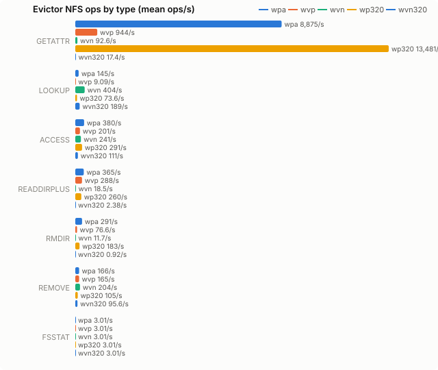
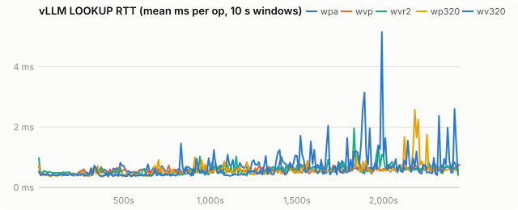
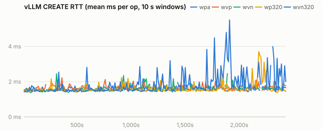
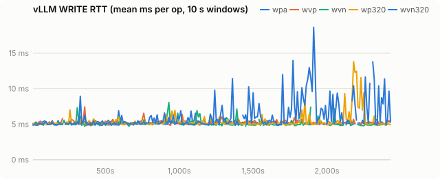
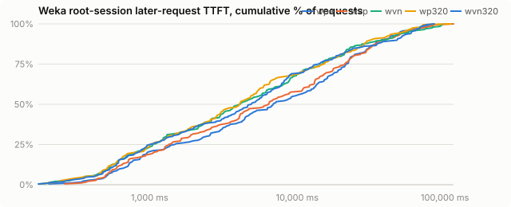

# Final: Python pvc_evictor vs kvreap on VAST, replayed Claude Code sessions, Qwen2.5-72B TP=4

| run | evictor image |
|---|---|
| wpa | `quay.io/wseaton/pvc-evictor:a-f62b9a7` |
| wvp | `quay.io/wseaton/kvreap:r-37c777a` |
| wvr2 | `quay.io/wseaton/kvreap:r-75c1b4a` |
| wp320 | `quay.io/wseaton/pvc-evictor:a-f62b9a7` |
| wv320 | `quay.io/wseaton/kvreap:r-75c1b4a` |

Replayed Claude Code sessions (SemiAnalysis Weka traces, AIPerf; see [Workload](#workload)) against Qwen/Qwen2.5-72B-Instruct, TP=4, fp8 KV, YaRN to 131,072 tokens, 4× H200, fs tier on a shared VAST PVC through the striped tier plugin, CPU tier 32 GiB, cleanup 85%, target 70%, hot threshold 2 minutes. 40 minutes of load per run, at two cache sizes. vLLM publishes KV events in every run; only the chain-aware runs subscribe.

| run | evictor | cache | load start (UTC) |
|---|---|---|---|
| wpa | Python `pvc_evictor` (llm-d-kv-cache main) | 160 GiB | 2026-10-12 00:06 |
| wvp | kvreap plain LRU (`KV_EVENTS_ENDPOINTS` empty), `r-37c777a` | 160 GiB | 2026-10-12 01:41 |
| wvr2 | kvreap chain-aware, `r-75c1b4a` | 160 GiB | 2026-10-12 05:04 |
| wv320 | kvreap chain-aware, `r-75c1b4a` | 320 GiB | 2026-10-12 10:28 |
| wp320 | Python `pvc_evictor` | 320 GiB | 2026-10-12 12:11 |

All runs used vLLM node gf48cf2, one after another; a second H200 node could not start pods (full root disk). `r-75c1b4a` is the release candidate; plain LRU does not use the chain index, so the earlier image measures it equally.

## Findings

| | wpa: Python 160 | wvp: plain 160 | wvr2: chain 160 | wp320: Python 320 | wv320: chain 320 |
|---|---|---|---|---|---|
| requests completed in 40 min | 618 | 632 | **704** (+14%) | 699 | **827** (+18%) |
| prompt tokens served from the fs tier | 2.9M of 15.7M | 2.7M of 15.1M | **7.4M of 18.1M** | 7.0M of 18.8M | **15.2M of 24.8M** |
| first-request TTFT p90 | 33.9 s | 20.2 s | 18.1 s | 20.3 s | **16.2 s** |
| later main-agent TTFT p50 | 7.0 s | 6.4 s | **4.0 s** | 4.1 s | **4.0 s** |
| later main-agent TTFT p90 / p99 | 37.2 / 75.2 s | 39.3 / 83.1 s | 36.9 / 111.2 s | **31.1 / 70.4 s** | 38.6 / 92.2 s |
| failed fs reads (deleted between lookup and read) | 302 | 145 | 908 | 413 | **8** |
| deletions that cut a live chain (internal) | not tracked | not tracked | 556 | not tracked | 135 |
| KV written to VAST | 3.47 TB | 3.43 TB | 3.38 TB | 3.44 TB | **3.07 TB** |
| evictor NFS metadata ops/s (mean) | 10,225 | 1,687 | 2,081 | 14,397 | **398** |
| max usage / quota rejections | 90.1% / 0 | 90.4% / 0 | 91.2% / 0 | 87.6% / 0 | 88.1% / 0 |

- **Chain-aware eviction completes 14-18% more requests and serves 2.2-2.5× the prompt tokens from VAST** than the Python evictor at the same cache size. kvreap's plain LRU ties the Python evictor (632 vs 618), so the gain is the eviction choice.
- **The gain is much smaller than on a synthetic agent load** ([agent-pool-vast.md](agent-pool-vast.md): +63% requests). These sessions are long and the GPU prefix cache serves 49-59% of prompt tokens in every run; the fs tier serves at most 31%.
- **Cache size decides the read races.** At 160 GiB the live sessions do not fit, every evictor cuts some, and chain-aware cuts the least recently used ones: sessions coming back from think time. vLLM checks a block exists and reads it later; deleted in between, the read fails and vLLM recomputes. Chain-aware has 3× the Python evictor's failed reads there. At 320 GiB finished sessions fit, chain-aware deletes those, and failed reads drop to 8 against 413.
- **Tail latency is queueing, not eviction.** The load grows as sessions grow, and in the second half of every run vLLM has requests waiting most of the time. Chain-aware completes more requests and keeps the queue as long; its median later-turn TTFT is lower and its p90/p99 are not. Compare requests completed and tokens served, not tail TTFT.
- **Metadata cost.** The Python evictor crawls at 10-14k NFS metadata ops/s; chain-aware kvreap stays at 400-2,100.
- **Context overflow.** AIPerf rebuilds some subagent prompts past the 131,072-token context; the same requests fail in every run that reaches them (21-39 per run).

n = 1 per configuration, back to back on one node with identical settings. The synthetic agent-load results are in [agent-pool-vast.md](agent-pool-vast.md).

## Workload

Replayed Claude Code sessions from the SemiAnalysis Weka trace corpus (`semianalysisai/cc-traces-weka-062126-256k`, revision `8fecd2f`: 393 sessions, 68,266 model requests, subagents included) with NVIDIA AIPerf 0.13.0, image `quay.io/wseaton/kvbench-aiperf:0.13.0-w062126` built from `bench/aiperf-image/`. Each trace records, per request, the input length, output length, think time and the request's 64-token KV block hashes. AIPerf rebuilds every prompt from those hashes and replays the session's recorded history (not the live responses), so every run sends the same token sequences and the prefix sharing of the real sessions, inside a session and between a session and its subagents, is reproduced exactly. Traces share nothing with each other.

| choice | value | why |
|---|---|---|
| model | Qwen2.5-72B-Instruct, TP=4, fp8 KV, YaRN ×4 to 131,072 tokens | same model and KV size (164 KB/token) as the earlier 72B runs; Claude Code contexts run past 100k tokens. vLLM 0.31 needs `max_position_embeddings` raised in `--hf-overrides` as well as `rope_parameters`. |
| corpus | the 256k-capped variant | the full-context corpus has requests up to 1M tokens |
| dropped requests | input over 120,000 tokens | leaves room in 131,072 for the output and for AIPerf's rebuilt history, which can run several percent past the recorded input length. This drops 36% of the corpus's requests: 58% of main-agent turns (Claude Code's main context usually runs past 120k before it compacts) and 21% of subagent requests. A main session replays until its context passes 120k tokens, then skips to its next compaction and continues from there. |
| sessions in flight | 6 | AIPerf concurrency mode: 6 traces at a time, each with its subagents; a finished trace is replaced by the next one in corpus order (96 loaded, about 20 started per run) |
| think time | the recorded per-request think time, capped at 60 s | keeps the gaps between tool calls and the user's short pauses; drops the hour-long breaks |
| output | the recorded length, `ignore_eos`, temperature 0; main-agent outputs capped at 1,024 tokens | identical decode work in every run |
| GPU KV cache | 40,960 blocks (655k tokens) | 6 sessions plus their subagents keep 0.8-1.4M tokens of context live (requests within the last 90 s), more than the GPU holds |
| CPU tier | 32 GiB (210k tokens) | as before |
| fs tier | 160 GiB (1.05M tokens) and 320 GiB (2.1M tokens) | 160 GiB is about the live working set, so every evictor has to cut live sessions; 320 GiB also holds the finished sessions and subagent chains |

Pilots (not reported): 16 sessions queued requests for minutes (TTFT p50 20 s); 8 with a 1M-token GPU cache kept more context live than the fs tier holds and the evictor rewrote live prefixes at 2.6 GB/s; 4 sessions barely touched the fs tier.

## Setup

| setting | value |
|---|---|
| model | Qwen/Qwen2.5-72B-Instruct |
| vLLM image | docker.io/vllm/vllm-openai:v0.31.0 |
| max model length | 131072 |
| HF config overrides | {'max_position_embeddings': 131072, 'rope_parameters': {'rope_type': 'yarn', 'factor': 4.0, 'original_max_position_embeddings': 32768, 'rope_theta': 1000000.0}} |
| cache size (PVC, or budget on the host path) | 160Gi / 320Gi |
| storage class | kvreap-bench-vast |
| load duration (s) | 2400 |
| offload block (tokens) | 16 |
| CPU tier (bytes) | 34359738368 |
| GPU KV blocks | 40960 |
| workload | weka |
| AIPerf image | quay.io/wseaton/kvbench-aiperf:0.13.0-w062126 |
| Weka dataset | semianalysis_cc_traces_weka_062126_256k |
| traces loaded | 96 |
| concurrent sessions | 6 |
| max input tokens (longer requests dropped) | 120000 |
| max output tokens (root sessions) | 1024 |
| think-time cap (s) | 60.0 |
| random seed | 42 |

Time axes are seconds since the load generator started.

## PVC usage

<picture><source media="(prefers-color-scheme: dark)" srcset="final-vast/charts/usage-dark.svg"></picture>

## Evictor metadata load

<picture><source media="(prefers-color-scheme: dark)" srcset="final-vast/charts/evictor-ops-dark.svg"></picture>

## Evictor ops by type

<picture><source media="(prefers-color-scheme: dark)" srcset="final-vast/charts/evictor-op-types-dark.svg"></picture>

## vLLM LOOKUP latency

<picture><source media="(prefers-color-scheme: dark)" srcset="final-vast/charts/rtt-lookup-dark.svg"></picture>

## vLLM CREATE latency

<picture><source media="(prefers-color-scheme: dark)" srcset="final-vast/charts/rtt-create-dark.svg"></picture>

## vLLM WRITE latency

<picture><source media="(prefers-color-scheme: dark)" srcset="final-vast/charts/rtt-write-dark.svg"></picture>

## vLLM READ latency

<picture><source media="(prefers-color-scheme: dark)" srcset="final-vast/charts/rtt-read-dark.svg"></picture>

## TTFT of requests that can reuse a prefix

<picture><source media="(prefers-color-scheme: dark)" srcset="final-vast/charts/ttft-dark.svg"></picture>

## All metrics

| metric | wpa | wvp | wvr2 | wp320 | wv320 |
|---|---|---|---|---|---|
| load duration (s) | 2,436 | 2,442 | 2,442 | 2,445 | 2,439 |
| **evictor metadata ops/s (mean)** | 10,224.8 | 1,686.7 | 2,081.1 | 14,396.7 | 398.4 |
| evictor metadata ops (total) | 24,897,367 | 4,117,288 | 5,081,986 | 35,185,639 | 971,629 |
| evictor ACCESS/s (mean / p95 10s) | 379.8 / 926.3 | 200.5 / 780.9 | 232.6 / 1,068.4 | 291.0 / 868.7 | 103.2 / 995.5 |
| evictor CREATE/s (mean / p95 10s) | - | 0.0 / 0.0 | 0.0 / 0.0 | - | 0.0 / 0.0 |
| evictor FSINFO/s (mean / p95 10s) | 0.0 / 0.0 | 0.0 / 0.0 | 0.0 / 0.0 | 0.0 / 0.0 | 0.0 / 0.0 |
| evictor FSSTAT/s (mean / p95 10s) | 3.0 / 3.1 | 3.0 / 3.1 | 3.0 / 3.1 | 3.0 / 3.1 | 3.0 / 3.1 |
| evictor GETATTR/s (mean / p95 10s) | 8,875.3 / 19,071.5 | 944.4 / 3,943.5 | 1,075.3 / 5,539.0 | 13,481.0 / 22,268.5 | 22.2 / 130.2 |
| evictor LOOKUP/s (mean / p95 10s) | 144.8 / 506.5 | 9.1 / 62.2 | 222.6 / 996.2 | 73.6 / 250.9 | 174.2 / 1,568.4 |
| evictor NULL/s (mean / p95 10s) | 0.0 / 0.0 | 0.0 / 0.0 | 0.0 / 0.0 | 0.0 / 0.0 | 0.0 / 0.0 |
| evictor PATHCONF/s (mean / p95 10s) | 0.0 / 0.0 | 0.0 / 0.0 | 0.0 / 0.0 | 0.0 / 0.0 | 0.0 / 0.0 |
| evictor READ/s (mean / p95 10s) | - | 0.0 / 0.0 | 0.0 / 0.0 | - | 0.0 / 0.0 |
| evictor READDIRPLUS/s (mean / p95 10s) | 365.0 / 1,067.1 | 288.2 / 1,161.5 | 284.8 / 1,329.0 | 260.1 / 717.8 | 5.1 / 45.7 |
| evictor REMOVE/s (mean / p95 10s) | 166.2 / 385.2 | 165.0 / 670.4 | 177.8 / 871.0 | 104.6 / 378.0 | 88.6 / 799.3 |
| evictor RMDIR/s (mean / p95 10s) | 290.7 / 422.6 | 76.6 / 346.7 | 85.0 / 452.3 | 183.4 / 415.3 | 2.0 / 13.4 |
| evictor SETATTR/s (mean / p95 10s) | - | 0.0 / 0.0 | 0.0 / 0.0 | - | 0.0 / 0.0 |
| evictor WRITE/s (mean / p95 10s) | - | 0.0 / 0.0 | 0.0 / 0.0 | - | 0.0 / 0.0 |
| vLLM LOOKUP RTT ms (all) | 0.62 | 0.57 | 0.61 | 0.53 | 0.54 |
| vLLM LOOKUP RTT ms (deleting / idle) | 0.63 / 0.61 | 0.58 / 0.55 | 0.63 / 0.58 | 0.54 / 0.53 | 0.53 / 0.54 |
| vLLM GETATTR RTT ms (all) | 0.73 | 0.72 | 1.05 | 1.39 | 2.04 |
| vLLM GETATTR RTT ms (deleting / idle) | 0.67 / 0.79 | 0.68 / 0.76 | 1.05 / 1.05 | 0.72 / 1.54 | 1.61 / 2.07 |
| vLLM CREATE RTT ms (all) | 1.59 | 1.65 | 1.61 | 1.55 | 1.67 |
| vLLM CREATE RTT ms (deleting / idle) | 1.58 / 1.60 | 1.65 / 1.64 | 1.60 / 1.62 | 1.55 / 1.55 | 1.71 / 1.66 |
| vLLM RENAME RTT ms (all) | 2.61 | 2.65 | 2.60 | 2.55 | 2.71 |
| vLLM RENAME RTT ms (deleting / idle) | 2.60 / 2.62 | 2.65 / 2.64 | 2.58 / 2.63 | 2.55 / 2.55 | 2.78 / 2.71 |
| vLLM WRITE RTT ms (all) | 5.17 | 5.19 | 5.20 | 5.18 | 5.52 |
| vLLM WRITE RTT ms (deleting / idle) | 5.16 / 5.18 | 5.18 / 5.19 | 5.14 / 5.25 | 5.13 / 5.21 | 5.50 / 5.52 |
| vLLM READ RTT ms (all) | 3.89 | 4.03 | 4.23 | 4.59 | 4.88 |
| vLLM READ RTT ms (deleting / idle) | 3.72 / 4.01 | 4.05 / 4.02 | 4.22 / 4.24 | 3.89 / 4.65 | 4.54 / 4.90 |
| vLLM LOOKUP client queue ms | 0.003 | 0.003 | 0.004 | 0.004 | 0.004 |
| vLLM GETATTR client queue ms | 0.004 | 0.005 | 0.007 | 0.005 | 0.006 |
| vLLM CREATE client queue ms | 0.003 | 0.003 | 0.004 | 0.003 | 0.004 |
| vLLM RENAME client queue ms | 0.012 | 0.013 | 0.015 | 0.014 | 0.014 |
| vLLM WRITE client queue ms | 0.158 | 0.171 | 0.181 | 0.169 | 0.181 |
| vLLM READ client queue ms | 0.015 | 0.016 | 0.019 | 0.015 | 0.016 |
| vLLM FS read s/GiB | 3.59 | 3.55 | 3.55 | 3.80 | 3.90 |
| vLLM FS write s/GiB | 2.31 | 2.16 | 2.47 | 1.79 | 1.87 |
| vLLM metadata ops/s | 2,475.6 | 2,349.7 | 2,716.2 | 2,380.5 | 3,191.5 |
| prune cycles | 16 | 16 | 16 | 6 | 8 |
| prune seconds (median) | 65.4 | 60.1 | 30.1 | 120.7 | 15.3 |
| max usage % | 90.1 | 90.4 | 91.2 | 87.6 | 88.1 |
| % time >= cleanup threshold | 13.2 | 7.4 | 9.1 | 4.5 | 3.3 |
| hot ttft p50 ms | - | - | - | - | - |
| hot ttft p90 ms | - | - | - | - | - |
| hot ttft p99 ms | - | - | - | - | - |
| weka requests | 618 | 632 | 704 | 699 | 827 |
| weka failed | 21 | 21 | 21 | 39 | 39 |
| weka cancelled | 0 | 0 | 0 | 0 | 0 |
| weka sessions | 19 | 19 | 20 | 19 | 21 |
| weka ttft p50 ms | 6,680.5 | 6,911.0 | 4,824.7 | 5,091.0 | 5,245.0 |
| weka ttft p90 ms | 50,861.0 | 50,784.6 | 64,625.0 | 52,903.6 | 56,370.8 |
| weka ttft p99 ms | 96,127.8 | 99,035.7 | 129,440.1 | 85,655.0 | 105,322.6 |
| weka first ttft p50 ms | 4,968.9 | 7,883.2 | 6,457.6 | 6,723.9 | 5,895.8 |
| weka first ttft p90 ms | 33,926.3 | 20,150.4 | 18,087.5 | 20,278.2 | 16,208.6 |
| weka later ttft p50 ms | 6,953.9 | 6,417.3 | 4,044.8 | 4,073.5 | 3,990.6 |
| weka later ttft p90 ms | 37,244.8 | 39,284.8 | 36,915.6 | 31,146.0 | 38,580.1 |
| weka later ttft p99 ms | 75,187.2 | 83,073.8 | 111,232.7 | 70,356.0 | 92,156.6 |
| weka subagent ttft p50 ms | 6,449.7 | 7,274.4 | 5,362.8 | 5,647.4 | 5,994.9 |
| weka subagent ttft p90 ms | 56,227.2 | 53,676.7 | 66,363.0 | 58,670.5 | 62,110.5 |
| weka subagent ttft p99 ms | 100,774.0 | 100,605.9 | 134,366.9 | 86,369.4 | 105,851.5 |
| weka prompt tok per s | 14,420.9 | 14,829.1 | 17,056.3 | 16,732.8 | 19,936.2 |
| weka output tok per s | 135.0 | 138.5 | 156.0 | 153.7 | 179.8 |
| hot requests (failed) | - (-) | - (-) | - (-) | - (-) | - (-) |
| churn input tok/s | - | - | - | - | - |
| vLLM log: quota_exceeded | 0 | 0 | 0 | 0 | 0 |
| vLLM log: store_failed | 0 | 0 | 0 | 0 | 0 |
| vLLM log: load_failed | 302 | 145 | 908 | 413 | 8 |
| chain deletions: heads (root + orphan) | - | - | - | - | - |
| chain deletions: root | - | - | 8 | - | 0 |
| chain deletions: orphan (parent gone) | - | - | 142,109 | - | 76 |
| chain deletions: internal | - | - | 556 | - | 135 |
| chain deletions: leaf | - | - | 289,382 | - | 215,916 |
| chain deletions: untracked | - | - | 2,108 | - | 0 |
| chain deferrals | - | - | - | - | - |
| chain deletions: cascaded below a deleted root | - | - | 432,421 | - | 215,819 |
| blocks announced without a digest | - | - | 0 | - | 0 |
| leaf edges skipped as too young | - | - | 54,455 | - | 0 |
| young leaf edges deleted under pressure | - | - | - | - | - |
| young leaf edges deleted in the emergency band | - | - | - | - | - |
| KV event batches received | - | - | 20,805 | - | 24,324 |
| KV event decode errors | - | - | 0 | - | 0 |
| `vllm:external_prefix_cache_hits_total{engine="0",model_name="Qwen/Qwen2.5-72B-Instruct"}` Δ | 2,931,296 | 2,652,544 | 7,421,104 | 6,977,184 | 15,207,072 |
| `vllm:external_prefix_cache_queries_total{engine="0",model_name="Qwen/Qwen2.5-72B-Instruct"}` Δ | 15,748,119 | 15,085,913 | 18,054,813 | 18,830,849 | 24,761,633 |
| `vllm:kv_offload_allocation_failure_total{engine="0",model_name="Qwen/Qwen2.5-72B-Instruct"}` Δ | 80 | 20 | 100 | 91 | 288 |
| `vllm:kv_offload_load_bytes_total{engine="0",model_name="Qwen/Qwen2.5-72B-Instruct"}` Δ | 482,790,604,800 | 441,429,524,480 | 1,217,058,570,240 | 1,162,336,010,240 | 2,505,024,471,040 |
| `vllm:kv_offload_load_time_total{engine="0",model_name="Qwen/Qwen2.5-72B-Instruct"}` Δ | 16 | 15 | 42 | 38 | 83 |
| `vllm:kv_offload_store_bytes_total{engine="0",model_name="Qwen/Qwen2.5-72B-Instruct"}` Δ | 3,469,368,360,960 | 3,427,150,069,760 | 3,376,013,639,680 | 3,441,413,324,800 | 3,072,810,024,960 |
| `vllm:kv_offload_store_time_total{engine="0",model_name="Qwen/Qwen2.5-72B-Instruct"}` Δ | 156 | 149 | 155 | 148 | 143 |
| `vllm:kv_offload_tiering_cascade_job_failures_total{engine="0",model_name="Qwen/Qwen2.5-72B-Instruct",tier="1:StripedFileSystemTierManager"}` Δ | 2 | 1 | 4 | - | - |
| `vllm:kv_offload_tiering_chunk_hits_total{engine="0",model_name="Qwen/Qwen2.5-72B-Instruct",tier="0:primary"}` Δ | 145,609 | 105,245 | 126,561 | 119,255 | 113,733 |
| `vllm:kv_offload_tiering_chunk_hits_total{engine="0",model_name="Qwen/Qwen2.5-72B-Instruct",tier="1:StripedFileSystemTierManager"}` Δ | 137,994 | 160,180 | 453,071 | 451,335 | 1,031,910 |
| `vllm:kv_offload_tiering_chunk_queries_total{engine="0",model_name="Qwen/Qwen2.5-72B-Instruct",tier="0:primary"}` Δ | 1,010,673 | 967,439 | 1,172,741 | 1,236,148 | 1,653,743 |
| `vllm:kv_offload_tiering_chunk_queries_total{engine="0",model_name="Qwen/Qwen2.5-72B-Instruct",tier="1:StripedFileSystemTierManager"}` Δ | 138,799 | 160,965 | 453,821 | 452,108 | 1,032,711 |
| `vllm:kv_offload_tiering_promotion_allocation_failures_total{engine="0",model_name="Qwen/Qwen2.5-72B-Instruct"}` Δ | - | 16 | 306 | 2,409 | 6,998 |
| `vllm:kv_offload_tiering_promotion_job_failures_total{engine="0",model_name="Qwen/Qwen2.5-72B-Instruct",tier="1:StripedFileSystemTierManager"}` Δ | 80 | 38 | 29 | 39 | 5 |
| `vllm:kv_offload_tiering_read_bytes_total{engine="0",model_name="Qwen/Qwen2.5-72B-Instruct",tier="1:StripedFileSystemTierManager"}` Δ | 390,500,188,160 | 485,676,810,240 | 1,379,954,851,840 | 2,332,137,881,600 | 7,826,655,150,080 |
| `vllm:kv_offload_tiering_read_time_total{engine="0",model_name="Qwen/Qwen2.5-72B-Instruct",tier="1:StripedFileSystemTierManager"}` Δ | 1,305 | 1,604 | 4,561 | 8,261 | 28,406 |
| `vllm:kv_offload_tiering_write_bytes_total{engine="0",model_name="Qwen/Qwen2.5-72B-Instruct",tier="1:StripedFileSystemTierManager"}` Δ | 3,470,713,159,680 | 3,431,179,223,040 | 3,377,358,438,400 | 3,446,774,169,600 | 3,075,494,379,520 |
| `vllm:kv_offload_tiering_write_time_total{engine="0",model_name="Qwen/Qwen2.5-72B-Instruct",tier="1:StripedFileSystemTierManager"}` Δ | 7,473 | 6,918 | 7,759 | 5,733 | 5,363 |
| `vllm:kv_offload_total_bytes_total{engine="0",model_name="Qwen/Qwen2.5-72B-Instruct",transfer_type="CPU_to_GPU"}` Δ | 482,790,604,800 | 441,429,524,480 | 1,217,058,570,240 | 1,162,336,010,240 | 2,505,024,471,040 |
| `vllm:kv_offload_total_bytes_total{engine="0",model_name="Qwen/Qwen2.5-72B-Instruct",transfer_type="GPU_to_CPU"}` Δ | 3,469,368,360,960 | 3,427,150,069,760 | 3,376,013,639,680 | 3,441,413,324,800 | 3,072,810,024,960 |
| `vllm:kv_offload_total_time_total{engine="0",model_name="Qwen/Qwen2.5-72B-Instruct",transfer_type="CPU_to_GPU"}` Δ | 16 | 15 | 42 | 38 | 83 |
| `vllm:kv_offload_total_time_total{engine="0",model_name="Qwen/Qwen2.5-72B-Instruct",transfer_type="GPU_to_CPU"}` Δ | 156 | 149 | 155 | 148 | 143 |
| `vllm:prefix_cache_hits_total{engine="0",model_name="Qwen/Qwen2.5-72B-Instruct"}` Δ | 20,011,376 | 21,379,696 | 23,345,376 | 22,460,096 | 24,299,520 |
| `vllm:prefix_cache_queries_total{engine="0",model_name="Qwen/Qwen2.5-72B-Instruct"}` Δ | 35,759,495 | 36,465,609 | 41,400,189 | 41,290,945 | 49,061,153 |
