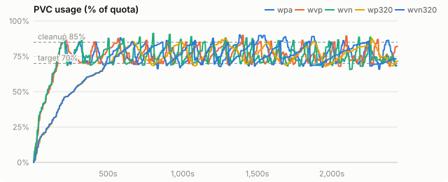
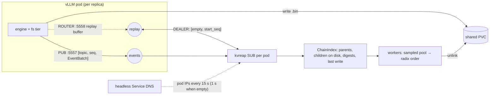

# Radix eviction for shared KV cache tiers

Evicting a vLLM filesystem KV tier by prefix-tree leaf edge, aged by each session's last use, instead of by file age. On replayed Claude Code sessions it completes 14-18% more requests than the llm-d Python evictor and serves twice the prompt tokens from disk; on a synthetic agent load the gain was +63%.

Will Eaton, October 2026. vLLM 0.31.0, llm-d, KServe LLMInferenceService. Branch [`claude/spike-chain-aware-eviction-e74b90`](https://github.com/wseaton/kvreap/tree/claude/spike-chain-aware-eviction-e74b90).

## Summary

Replayed Claude Code sessions (SemiAnalysis Weka traces, AIPerf), Qwen2.5-72B TP=4, shared VAST PVC:

| result | what |
|----|----|
| **+14% / +18%** | requests vs the Python pvc_evictor, 160 / 320 GiB cache |
| **2.2-2.5×** | prompt tokens served from disk |
| **−42%** | later-turn TTFT p50 at 160 GiB (7.0 s → 4.0 s) |
| **5-36× fewer** | evictor NFS metadata ops |

- **Plain eviction does not delete chains from the head.** On the first benchmark, 43% of kvreap's deletions cut a prefix chain in the middle and 40% removed tails an earlier cut had already made useless. vLLM's prefix lookup stops at the first missing block, so a mid-chain cut wastes everything below it.
- **Chain-aware eviction** deletes only radix-tree leaf edges: the unshared tail of one cached prefix, ordered by its last use (written to the tier, or loaded or computed again), so finished sessions go first and a prefix shared by two continuations is never deleted. This is the RadixAttention leaf-first LRU policy [24] moved from GPU memory to a filesystem tier, driven by vLLM's KV events. It turns on whenever kvreap is given vLLM's events endpoint.
- **vLLM 0.31's fs tier read path had to be fixed first.** It reads each promotion on one thread (about 0.57 GB/s on a VAST mount that serves 16 GB/s). Until that changes, a disk hit is no faster than recompute and no eviction policy helps TTFT. An out-of-tree striped tier fixes it today; vllm#58404 [6] fixes it upstream.
- **On real agent traces the gain is real but modest.** Against the llm-d Python evictor kvreap completes 14% (160 GiB) to 18% (320 GiB) more requests and serves 2.2-2.5× the prompt tokens from disk, at a fraction of the metadata load. The GPU prefix cache serves about half of all prompt tokens on these long sessions, and tail TTFT is set by vLLM's request queue for every evictor, so tails do not improve. kvreap's own plain LRU ties the Python evictor, so the gain is the eviction choice.
- **Cache size matters.** When the cache cannot hold the live sessions (160 GiB), chain-aware eviction cuts the least recently used ones and fails 3× more reads than the Python evictor. With room for finished sessions (320 GiB) it deletes those and failed reads fall to 8 against 413.
- **On a synthetic agent load**, where finished sessions are always available, the gain was +63% requests and an 8× lower p99 ([synthetic results](#synthetic-agent-load)).
- **On node-local NVMe** the Python evictor cannot run at all (statvfs reports the whole node); kvreap's chain-aware mode beats its plain LRU by 15% requests there.
- **Hardening found eight real bugs** across the runs, including one that deleted live sessions and one that aged sessions by write instead of use; [all are fixed](#hardening-for-tech-preview) and the code is about a thousand lines smaller.

**Release candidate:** image `r-75c1b4a`. [Final results](#final-results) are on the Claude Code replay; earlier sections keep the runs that led there.

## Final results

Replayed Claude Code sessions: the SemiAnalysis Weka corpus (`cc-traces-weka-062126-256k`, 393 sessions with their subagents), replayed with NVIDIA AIPerf 0.13.0. Each trace records per-request input and output lengths, think time and 64-token KV block hashes; AIPerf rebuilds the prompts from the hashes, so prefix sharing within a session and with its subagents is reproduced exactly. Qwen2.5-72B-Instruct, TP=4, fp8 KV, YaRN to 131,072 tokens (requests over 120k input are dropped, 36% of the corpus), 6 sessions at a time, think time capped at 60 s, 40 minutes per run, cleanup 85%, target 70%. Details in [benchmarks/final-vast.md](https://github.com/wseaton/kvreap/blob/claude/spike-chain-aware-eviction-e74b90/benchmarks/final-vast.md).

### Shared VAST PVC, 160 and 320 GiB

| | Python 160 | plain 160 | chain 160 | Python 320 | chain 320 |
|----|----|----|----|----|----|
| requests in 40 min | 618 | 632 | 704 | 699 | 827 |
| prompt tokens served from the fs tier | 2.9M | 2.7M | 7.4M | 7.0M | 15.2M |
| later main-agent TTFT p50 | 7.0 s | 6.4 s | 4.0 s | 4.1 s | 4.0 s |
| later main-agent TTFT p90 / p99 | 37 / 75 s | 39 / 83 s | 37 / 111 s | 31 / 70 s | 39 / 92 s |
| failed fs reads | 302 | 145 | 908 | 413 | 8 |
| deletions that cut a live chain | | | 556 | | 135 |
| KV written to VAST | 3.47 TB | 3.43 TB | 3.38 TB | 3.44 TB | 3.07 TB |
| evictor NFS metadata ops/s | 10,225 | 1,687 | 2,081 | 14,397 | 398 |

*n = 1 each, back to back on one H200 node with identical settings. Python `pvc-evictor:a-f62b9a7`; plain LRU `r-37c777a`; chain-aware `r-75c1b4a`.*

### Node-local NVMe, 160 GiB budget

| | plain LRU | chain-aware |
|----|----|----|
| requests in 40 min | 643 | 742 (+15%) |
| prompt tokens served from the fs tier | 4.4M | 9.9M |
| later main-agent TTFT p50 / p99 | 4.7 / 71 s | 3.6 / 90 s |
| failed fs reads | 218 | 1,648 |
| max usage of the budget | 85.2% | 95.0% |

*[benchmarks/final-nvme.md](https://github.com/wseaton/kvreap/blob/claude/spike-chain-aware-eviction-e74b90/benchmarks/final-nvme.md).*

### Tiered NVMe + VAST

vLLM 0.31 writes every block to all secondary tiers and loads from the first tier in list order that has it, with no demotion between tiers [22]. Each fs tier sets `locality` (`LOCAL`/`REMOTE`), and its STORAGE events carry it [20]. kvreap runs one instance per tier with `KV_EVENTS_LOCALITY`; the node-local instance is a sidecar in the vLLM pod and treats the shared tier's copy as backing when deciding whether a chain is cut. On the Claude Code replay an 80 GiB NVMe tier turns over in about a minute and kvreap ran it to 99.5% of its budget (155% before shortening its hot threshold), so tiered stays experimental.

## Synthetic agent load

Qwen2.5-72B-Instruct, TP=4, fp8 KV, 4× H200 per run, striped fs tier. The nyann-bench agent load:

- 32 sessions in rotation, 8 requests in flight.
- Each session has a 2,048-token shared preamble, an 8,000-token first turn, and up to 30 turns of 500 tokens.
- 40 minutes per run, a 160 GiB cache, cleanup at 85%, target 70%, hot threshold 2 minutes.

This sizing keeps live sessions near the target while finished sessions push usage over it, which is the regime where eviction choice decides the outcome.

### Shared VAST PVC: Python pvc_evictor vs kvreap

|  | Python pvc_evictor | kvreap plain LRU | kvreap chain-aware | chain-aware vs Python |
|----|----|----|----|----|
| requests in 40 min | 2,748 | 2,734 | 4,471 | +63% |
| prefix tokens served from offload tiers | 35.5M of 48.8M | 34.4M of 48.3M | 74.6M of 78.9M | 2.1× |
| returning-turn TTFT p50 | 645 ms | 643 ms | 645 ms |  |
| returning-turn TTFT p90 | 6,295 ms | 4,408 ms | 993 ms | 6.3× lower |
| returning-turn TTFT p99 | 18,104 ms | 11,032 ms | 2,187 ms | 8.3× lower |
| first-turn TTFT p90 | 6,102 ms | 3,810 ms | 2,719 ms | 2.2× lower |
| KV rewritten to VAST | 2.19 TB | 2.29 TB | 0.72 TB | −67% |
| evictor NFS metadata ops/s (mean) | 14,765 | 879 | 2,801 | 5.3× fewer |
| deletions that cut a live chain | not tracked | 110,889 | 1 |  |
| vLLM load failures / quota rejections | 266 / 0 | 851 / 0 | 0 / 0 |  |
| max usage | 91.6% | 86.5% | 96.6% |  |

*Python `pvc-evictor:a-f62b9a7` (llm-d-kv-cache main) and plain LRU (`r-962281f`) ran on 2026-10-10; chain-aware `r-db6a55b` on 2026-10-11 with identical settings. [benchmarks/final-vast.md](https://github.com/wseaton/kvreap/blob/claude/spike-chain-aware-eviction-e74b90/benchmarks/final-vast.md).*

All three keep usage below VAST's quota, so the Python evictor does work on VAST. It deletes whatever its crawl reaches first, plain LRU deletes oldest-written first, and both cut live sessions at their first-turn blocks, so every later turn of a cut session recomputes and rewrites from the cut. Chain-aware eviction deletes finished sessions whole and keeps live ones intact. It runs usage higher (peak 96.6%, 12.9% of the run above cleanup against 6.6%): below a pressure line at 91% it holds back sessions written in the last 2 minutes while the sampler looks for finished ones.

*PVC usage. **pa**: Python pvc_evictor. **gw**: kvreap plain LRU. **vr7**: kvreap chain-aware, release candidate.*

*Evictor NFS metadata ops/s in 5 s windows.*

### Node-local NVMe: kvreap chain-aware vs plain LRU

For single-node deployments the cache can live on the node's own NVMe: CoreWeave mounts an encrypted 8-drive RAID10 at `/mnt/local`, 27.9 TiB per H200 node [35]. vLLM and kvreap share a hostPath, and kvreap runs on vLLM's node with `CAPACITY_BYTES` set to the budget.

|  | plain LRU | chain-aware | vs plain |
|----|----|----|----|
| requests in 40 min | 2,656 | 3,459 | +30% |
| prefix tokens served from offload tiers | 35.6M of 46.4M | 56.9M of 60.3M | +60% |
| returning-turn TTFT p90 | 2,390 ms | 1,704 ms | −29% |
| returning-turn TTFT p99 | 5,966 ms | 2,646 ms | 2.3× lower |
| KV rewritten to NVMe | 1.79 TB | 0.58 TB | −67% |
| deletions that cut a live chain | 82,501 | 33 |  |
| vLLM load failures | 29 | 0 |  |
| max usage of the 160 GiB budget | 102.1% | 91.4% |  |

*Plain LRU `r-0668381` on 2026-10-10; chain-aware `r-db6a55b` on 2026-10-11. [benchmarks/final-nvme.md](https://github.com/wseaton/kvreap/blob/claude/spike-chain-aware-eviction-e74b90/benchmarks/final-nvme.md).*

**The Python evictor cannot run on a hostPath.** It reads usage only from `statvfs` (`processes/activator.py`), and on `/mnt/local` that is the whole node RAID. [`benchmarks/hostpath-proof/`](https://github.com/wseaton/kvreap/tree/claude/spike-chain-aware-eviction-e74b90/benchmarks/hostpath-proof) runs its own `get_disk_usage_from_statvfs`, from its upstream image, after writing 20 GiB into a cache budgeted at 16 GiB:

    == df on the hostPath
    /dev/md127       28T  8.0T   20T  29% /kv-cache
    == before
      pvc_evictor sees: usage=28.49% of 27.9 TiB -> cleanup at 85% never triggers; 15.8 TiB more writes before it would
    == after writing 20G into a cache budgeted at 16 GiB (125%)
      pvc_evictor sees: usage=28.56% of 27.9 TiB -> cleanup at 85% never triggers; 15.8 TiB more writes before it would

## Hardening for tech preview

Rerunning the 72B benchmarks on each change, after the first final numbers, found the following. Each fix has a regression test.

| found by | problem | fix |
|----|----|----|
| kind e2e, 2 of 2 runs | Radix deleted a young edge whenever the pool looked empty, but it had just drained the pool into its window. The oldest files by atime are live sessions' first turns, so it deleted live sessions (687 and 1,069 blocks). | The pool is ordered by each block's edge's newest write, not atime, so finished sessions sort ahead of live ones (`60b9d0c`). |
| 72B VAST, strict hold | With young edges held until the emergency band, every live session was young early in the run: usage went 85% → 99.8% in 30 s and VAST rejected 2,142 stores for quota. | Hold young edges only below a pressure line halfway to the emergency band; plain LRU over edges above it (`9c19085`). |
| 72B VAST, pressure line | A pass that held young edges back evicted nothing, so workers backed off up to 30 s and slept through usage crossing the line: 977 quota rejections. | Backoff wakes as soon as usage crosses the line (`db6a55b`). |
| 72B NVMe | The `CAPACITY_BYTES` estimate trailed the disk: buckets were listed every 60 s and sampled once a second. The true footprint reached 110.9% of the budget. | List every 5 s, sample ten a second: peak 91.4% (`14a28a2`). |
| flaky unit test | Parallel unlink lanes checked the byte grant and subtracted after the unlink, overshooting by up to `DELETE_FANOUT` − 1 files. | Each lane reserves its bytes with one compare-and-swap first (`140bca0`). |
| Claude Code replay | Radix aged edges by their newest write. A long session's prefix is read back from disk every turn but rarely rewritten, so sessions in active use looked stale and were deleted mid-use: 5× the Python evictor's failed reads. | A GPU or CPU `BlockStored` for a block already on disk counts as a use; vLLM publishes one whenever it loads a block back (`75c1b4a`). Failed reads fell from 1,540 to 908 at 160 GiB and to 8 at 320 GiB. |
| flaky e2e | Within one edge, parallel lanes reserved grant bytes in schedule order, so a fresh grant could let lanes past a refused one delete blocks behind a kept one: a cut chain. | Reserve an edge's bytes in order before the parallel unlinks (`acd5036`). |
| tiered kind e2e | On a small node-local tier the sampled `CAPACITY_BYTES` estimate swung 20-30 points; a spike switched radix to plain LRU and cut a live session. | With KV events, usage counts the index's on-disk blocks and samples only files the index does not know (`37c777a`). |
| code review | Index nodes remembered every child ever linked, so a shared system prompt's list grew with every past conversation and each edge walk rescanned it. | Nodes keep only on-disk children (`a2dc0e1`). |

**Simplification.** The losing policies (`tail-first`, `subtree`, `observe`) and `CHAIN_EVICTION` are gone: chain-aware eviction is on whenever `KV_EVENTS_ENDPOINTS` is set, plain sampled LRU otherwise. The `BlockRemoved` publisher and its libzmq build went too, since nothing consumes those events with vLLM 0.31; with it went the second ZMQ stack. So did the lock instrumentation and a dozen counters. About a thousand lines left the crate.

## The problem

vLLM 0.31's `TieringOffloadingSpec` can spill KV blocks to a filesystem tier. Each block is one file at `<root>/<model>_<digest>_r<rank>/<hhh>/<hh>_g<group>/<hash>.bin` under the fs tier manager [22]. On a shared RWX PVC (VAST here), many vLLM replicas write into one tree and nothing deletes. vLLM's fs tier has no capacity bound today: vllm#52784 (closed) and #54327 (open) propose one [3, 2]. llm-d's Python `pvc_evictor` crawls the tree [12]. kvreap is a Rust drop-in replacement that samples random hex buckets into an oldest-first pool (Redis-style approximated LRU [25]) and deletes from 85% down to a 70% target.

Blocks form chains: block *k*'s hash covers every token before it. vLLM serves a prefix from cache only up to the first missing block. So which blocks go matters as much as how many.

## The first hypothesis was wrong

The starting assumption: oldest-first eviction deletes chain heads first, so a tail-first policy fixes it. The chain index showed otherwise. On Qwen3-0.6B with a churn plus hot-prefix load on 1× H200 and VAST (20 min per variant):

| deletions by chain position | c: plain | d: tail-first | e: subtree |
|----|----|----|----|
| root (first block of a prompt) | 529 | 549 | 18 |
| orphan (parent already gone) | 47,330 | 49,241 | 112,180 |
| internal (parent and a child still on disk) | 50,186 | 49,349 | 795 |
| leaf | 19,240 | 21,165 | 2 |
| cascaded below a deleted subtree root | 0 | 0 | 112,260 |

*benchmarks/chain-spike.md, from kvreap's `chains` counters.*

Random bucket sampling puts a chain's blocks into the pool at random times, so chains get cut in the middle whatever order the pool is drained in. A 256-block chain has one leaf, and a window of oldest candidates almost never holds it.

## Policies tried

| policy | rule | result |
|----|----|----|
| `observe` | plain sampled LRU; the index only classifies deletions | baseline |
| `tail-first` (D) | among the oldest candidates, dead blocks, then childless, deferring interiors up to 8 rounds | no measurable change (hits +4%) |
| `subtree` (E) | pick dead blocks first, then the block whose on-disk subtree frees the most blocks per lost leaf; delete it and everything below | +79% fs hits, +86% prefix hits, −91% promotion failures, −29% bytes written, p99 TTFT halved. Unsafe with shared system prompts: the oldest block is the shared one. |
| `radix` (R) | delete radix-tree leaf edges (fork to leaf), dead first, ordered by newest write; never delete a prefix with two or more on-disk continuations | wins on agentic load (below); shared prompts survive |

| Qwen3-0.6B | c (plain) | d (tail-first) | e (subtree) | e vs c |
|----|----|----|----|----|
| FS-tier chunk hits | 76,986 | 79,897 | 138,019 | +79% |
| external prefix-cache hits | 1.09M | 1.13M | 2.02M | +86% |
| promotion (load) failures | 158 | 186 | 14 | −91% |
| hot-prefix TTFT p50 / p99 ms | 492 / 3,378 | 476 / 1,638 | 562 / 1,687 | +14% / −50% |
| evictor metadata ops/s | 1,076 | 1,120 | 452 | −58% |
| fs bytes written by vLLM | 445 GB | 446 GB | 315 GB | −29% |

*n = 1 per variant. p50 rose because a 0.6B model recomputes a 2k prefix about as fast as VAST reads it back (see the break-even below).*

The shared-prompt problem with subtree eviction led to radix: protect any prefix that branches, and age whole unshared tails by the session's last write. vLLM's own GPU prefix cache already prefers evicting a request's tail blocks, because they hash more tokens and are less likely to be shared [23]. RadixAttention evicts the least recently used leaf first so common ancestors stay reusable [24].

### Ordering fix found by the kind e2e

The first radix version (`81c4ab0`…`b5a0097`) took candidates in file-age order and used an edge's newest write only to hold back edges younger than the hot threshold. A session's first turns are its oldest files, so a live session idle past the threshold lost its whole edge before finished sessions written later. `ddda807` sorts each window by dead, then unknown, then edge newest-write, oldest first. Young edges leave the pool instead of returning to every window. Radix also keeps its ordering in the 97% emergency band, where chain ordering had been switched off and eviction fell back to file age. All published agentic numbers predate this fix.

## The read path came first

vLLM 0.31's fs tier submits a request's whole promotion as one thread-pool task [22], so one thread reads about 1,250 files in sequence: about 0.57 GB/s per load, while the same VAST mount delivers 16 GB/s to 64 parallel readers. Reading a 20k-token fp8 prefix (2.6 GB) back was slower than recomputing it.

A hit beats recompute when

    read_bandwidth > prefill_tokens_per_s × kv_bytes_per_token

About 0.8 GB/s for Qwen3-32B fp8 on one H200. For fp8 KV, `kv_bytes_per_token = layers × kv_heads × head_dim × 2`: 131 KB on Qwen3-32B, 164 KB on Qwen2.5-72B.

`StripedFileSystemTierManager` ([`bench/vllm_plugins/striped_fs.py`](https://github.com/wseaton/kvreap/blob/claude/spike-chain-aware-eviction-e74b90/bench/vllm_plugins/striped_fs.py)) splits each load and store into one task per stripe and keeps upstream's keep-the-prefix-on-failure semantics. It loads through the tier factory's `module_path`, so vLLM needs no rebuild. On the 32-session agentic load with no eviction:

| Qwen3-32B, 10 min | stock fs tier | striped fs tier |
|----|----|----|
| returning-turn TTFT p50 / p90 / p99 ms | 5,651 / 6,612 / 8,258 | 857 / 1,288 / 1,683 |
| first-turn TTFT p50 / p90 ms | 4,824 / 13,246 | 4,080 / 6,829 |
| requests completed | 349 | 500 |

Upstream is doing the same: vllm#58404 batches work across the fs thread pool [6] under RFC #57106 [7], after #49225 and #51767 [8, 9] were closed. #53133 adds multi-path sharding and direct I/O [10], and RFC #54777 covers GDS [11]. GPUDirect was out of scope here.

## Agentic results

Load is nyann-bench [33] (`edd5f54`) in `conversation_pool` mode. Each session has a shared 2,048-token preamble, an 8,000-token first turn, then up to 30 turns of 500 new tokens with 200-token replies (prompts reach about 31k tokens), 8 requests in flight. Plain and radix ran at the same time on separate GPUs and PVCs, with the same image, so they saw the same storage.

### Qwen3-32B, TP=1, fp8, 32 sessions, 120Gi VAST

|  | plain LRU | radix | radix vs plain |
|----|----|----|----|
| requests in 40 min | 1,739 | 2,139 | +23% |
| prefix tokens served from offload tiers | 23.0M of 30.2M | 32.6M of 37.2M | +41% |
| returning-turn TTFT p50 | 847 ms | 864 ms | same |
| returning-turn TTFT p90 | 6,604 ms | 1,796 ms | 3.7× lower |
| returning-turn TTFT p99 | 27,365 ms | 18,035 ms | −34% |
| KV rewritten to the fs tier | 934 GB | 608 GB | −35% |
| deletions that cut a live chain | 71,756 | 623 | 115× fewer |
| prune cycles | 8 | 12 |  |

*Image r-c209808. benchmarks/chain-spike-agent.md.*

Plain LRU deletes by write time, so it deletes the turn-0 context of sessions that are still running. Every later turn of a cut session recomputes from the cut and writes the result again (+326 GB). The median turn hits either way. The win shows in the tail and in GPU time no longer spent recomputing.

### Qwen2.5-72B-Instruct, TP=4, fp8, 96 sessions, 500Gi VAST

|  | plain LRU | radix | radix vs plain |
|----|----|----|----|
| requests in 40 min | 4,330 | 4,495 | +3.8% |
| prefix tokens served from offload tiers | 65.7M of 71.1M | 69.7M of 74.3M | +6.0% |
| returning-turn TTFT p90 | 1,101 ms | 937 ms | −15% |
| returning-turn TTFT p99 | 3,340 ms | 1,257 ms | 2.7× lower |
| first-turn TTFT p90 | 2,974 ms | 3,669 ms | +23% |
| KV rewritten to the fs tier | 884 GB | 749 GB | −15% |
| deletions that cut a live chain | 57,034 | 56 | 1,000× fewer |
| prune cycles | 2 | 2 |  |

*Image r-b5a0097 (before the ordering fix). benchmarks/chain-spike-72b.md.*

The 500Gi PVC held most of the 96-session working set, so there was little to choose between and the margin is smaller than on 32B. The first-turn regression is unexplained at n = 1. First turns hit only the shared preamble, so a likely cause is radix serving more returning turns, which queues more prefill ahead of first turns at fixed concurrency.

**Benchmark sizing that works:** live sessions fit under the target and finished sessions push usage over it. nyann-bench's pool resumes the least recently used conversation, a cyclic order. With the working set far above capacity, that order defeats every LRU-like policy: 64 sessions on 100Gi got about 0 fs hits under both. With too much capacity, nothing is evicted. The running 72B pair uses 32 sessions on 160Gi: about 105 GB live against a 112 GB target, with sessions turning over every 9 minutes and the PVC holding about 7 minutes of writes.

## Stopping at target

Subtree and radix delete whole edges, and early versions overshot the 70% target to 56–66%. Usage polled from `statvfs` lags deletions on VAST, so a controller that keeps deleting until the reading drops overshoots by the lag times the delete rate. The fix (`449e603`, `cc799c4`, `b5a0097`):

- Each prune gets a fixed byte grant: usage above target, plus a 2% margin.
- Workers spend the grant as they unlink. The grant refills only from a reading taken at least `USAGE_LAG` (10 s) after the last delete.
- A spent grant keeps the worker's candidate pool, so selectivity survives the wait.

### The metadata-op limiter

kvreap paces stat and unlink with an AIMD rate that backs off when NFS latency rises. The first version halved on every 1 s tick while a slow-moving latency average sat above 3× its 2-minute minimum. One slowdown therefore cost a halving per second down to the 20 ops/s floor, and an external slowdown could never move the baseline. On a 72B VAST run it pinned radix at 20 ops/s while vLLM filled the PVC.

`0668381` changes this:

- Each tick is judged on its own mean latency, and only with at least 5 samples.
- After a cut, the limiter waits two ticks so it judges latency at the new rate, one reduction per round trip as in RFC 5681 [36].
- If latency has not dropped, the slowdown was not kvreap's. The cut is undone and the baseline moves, as LEDBAT's base delay follows the path [37].
- Ticks without enough samples do not grow the rate [38].

On the final VAST run the radix limiter never backed off. `1cc452e` fixed a second stall in the same run: a block the index had on disk but whose file was already gone pinned its edge. kvreap now drops such blocks from the index (counted as `vanished`) and keeps deleting.

On VAST, prunes ended at 69.99% and 70.00% (run `es4`). Without the margin, the last 1–2% trickled for 403 s. With it, the 72B prunes ended at 68.5% and 69.6% in 100–126 s.

## KV events and replay

- **Decoding.** vLLM 0.31 sends an array-like `EventBatch` `[ts, events, dp_rank]` with msgspec tagged-map events [20]. kvreap has a hand-written decoder with golden tests made from vLLM's own structs. It also accepts the legacy array layout.
- **Full hashes.** `VLLM_KV_EVENTS_USE_INT_BLOCK_HASHES` defaults to true [21], which sends 64-bit ints. Files are named by the full digest, so radix needs it set to 0. Without it, kvreap counts `undigested` blocks and cannot delete beyond the one sampled.
- **What is on disk.** GPU `BlockStored` events teach parent links. Only the fs tier's own `STORAGE` stores (`enable_kv_events: true`) mark a block on disk; counting GPU stores overcounted children by about 6×.
- **Dead means seen.** A parent makes its children dead only after kvreap saw it on disk and then removed. A block known only as a parent link no longer turns its subtree into deletion candidates.

### Gap detection and replay

ZeroMQ PUB drops messages for subscribers that are not connected yet (the slow-joiner problem the zguide answers with snapshots and the Clone pattern [28]; PUB/SUB semantics in RFC 29 [26]). kvreap starts after vLLM, and DNS can lag a new pod by 15 s. vLLM's `ZmqEventPublisher` keeps the last `buffer_steps = 10_000` batches and serves them on `replay_endpoint` [20]:

- The request is `[empty, start_seq u64 BE]`, which arrives at the ROUTER as `(client_id, b"", start_seq)`.
- The reply is `[empty, topic, seq, payload]` for every buffered seq ≥ start, then `[empty, b"", END_SEQ = −1, b""]`.
- Sequence numbers start at 0 from `itertools.count()`.

kvreap follows llm-d-router's subscriber [19] (`4ced8f9`):

- It replays on connect, on a gap (`seq > last + 1`), on joining mid-stream, and when seq goes backwards (vLLM restarted), and it skips duplicate live seqs.
- The limits match the router's constants: 2 min overall, 2 s idle per attempt, 3 attempts without progress, a 30 s cooldown after failure, and 8 replays at once.
- One deliberate difference: batches already gone from vLLM's buffer are counted as `events_lost` and the stream continues. The router treats them as a failed replay. A partial index still orders eviction better than none.

The replay port is `KV_EVENTS_REPLAY_PORT` (5558 in the KServe preset). vLLM offsets both ports by data-parallel rank [20]; kvreap assumes DP rank 0.

## Shipping: FIPS, security, KServe

### FIPS

kvreap links no cryptographic code. Event subscription uses the pure-Rust `zeromq` crate [29] (NULL mechanism only, ZMTP 3 [27]), and the libzmq-based `BlockRemoved` publisher, the one piece that pulled in SHA-1, has been removed. openshift/check-payload [30] rates the build inconclusive with no crypto provider and nothing flagged; the crate's `rand_chacha` is a PRNG for reconnect jitter and is not on its deny list. A test scans the binary for crypto and libzmq symbols. FIPS 140-3 [31] applies to crypto modules; kvreap ships none.

### Security

- **KV events carry prompt token ids** and kvreap implements no ZMQ authentication, the same as the EPP's own subscription. On OpenDataHub and RHOAI the KServe controller gives each LLMInferenceService a NetworkPolicy that admits every pod in its namespace on any port, and workload pods have no sidecar mesh, so the namespace is the boundary. NetworkPolicies are additive, so a narrower policy would restrict nothing there. Elsewhere, the opt-in `kv-events-policy` Component limits 5557 and 5558 to kvreap and the EPP.
- **Metrics.** kvreap serves Prometheus text over plain HTTP from the standard library, admitted only from the OpenShift monitoring namespaces. The opt-in `kvreap-metrics-rbac` Component puts the same kube-rbac-proxy OpenDataHub uses for InferenceService pods in front: TLS on 8443 from the service CA, TokenReview and SubjectAccessReview against `/metrics`. The kind e2e checks it the way Prometheus would: 200 with the scraper token, 401 without one, 403 without the grant, no connection from outside the monitoring namespaces.
- **uid.** On OpenShift the restricted-v2 SCC gives every pod in a namespace the same uid, so kvreap can unlink what vLLM writes with no `runAsUser`; a hard-coded uid would fail admission.

### KServe, OpenDataHub and RHOAI

- **Preset.** [`deploy/kserve/`](https://github.com/wseaton/kvreap/tree/claude/spike-chain-aware-eviction-e74b90/deploy/kserve) holds an `LLMInferenceServiceConfig` preset for `spec.baseRefs`: vLLM binds events on 5557 and replay on 5558, sends full hashes, and the fs tier publishes STORAGE events.
- **Per-service Component.** A kustomize Component adds a headless Service over the workload pods and the kvreap Deployment on the same PVC.
- **EPP discovery mode.** KServe's existing prefix-cache preset uses centralized events, which leaves nothing per-pod to subscribe to. The overlay requires the EPP's discovery mode (`discoverPods: true`, `socketPort: 5557`). The EPP's Go adapter takes the last 8 bytes of a byte hash, the same value vLLM sends as an int, so prefix scoring is unaffected.
- **API field.** KServe's rendered `--kv-transfer-config` cannot set `enable_kv_events`, so the preset supplies its own. [`wseaton/kserve@19b29bc`](https://github.com/wseaton/kserve/commit/19b29bc2e1669b70342508a8a77e7f1da2234813) adds `kvCacheOffloading.secondary[].fileSystem.kvEvents` [32]. The OpenDataHub fork and red-hat-data-services `rhoai-3.6` render the KV cache config with code identical to upstream, so the patch applies to both. RHOAI's KServe module vendors the CRD from a release ref, so the field reaches RHOAI only when that copy is refreshed.

## Testing

- **Unit and process e2e.** 143 unit tests and 18 process-level e2e tests, run on macOS and natively on linux/amd64. They cover a real ZMQ PUB plus ROUTER replay publisher, a dead replay port, edge ordering against file age, the pressure line, the emergency band, an edge whose leaf file vanished, concurrent grant reservation, and the limiter under external and self-caused slowdowns. Clippy is clean with `-D warnings`.
- **Kind e2e.** `tests/kind/e2e.sh` applies the KServe Components (kvreap, `kv-events-policy`, `kvreap-metrics-rbac`) against a fake vLLM labelled as an LLMInferenceService workload. The fake writes a shared preamble, 4 live sessions and a stream of short ones, publishes GPU and STORAGE events, and serves vLLM's replay protocol.
  - The fake starts first, so the preamble reaches kvreap only by replay.
  - A toxiproxy [34] sidecar cuts the PUB stream for 5 s after the first prune.
  - The cache is a 1 GiB tmpfs, so statvfs is real; the pod runs under the overlay's uid and NetworkPolicies.
  - It passes on the release candidate: no live blocks or preamble lost, 0 internal deletions, 1 gap, 2 replays, 0 lost batches, and the metrics checks above.
- **CI** runs fmt, clippy, the unit and e2e tests, the container build, the kind e2e, and ruff, pyright and pytest for the benchmark harness.

## Prior art

The principles exist elsewhere. Nobody upstream has built chain-aware eviction for a shared filesystem tier fed by KV events. Status as of 2026-10-10:

| idea | status | closest work |
|----|----|----|
| Leaf-first prefix-tree eviction | **known:** | RadixAttention evicts the least recently used leaf first [24]. vLLM's GPU prefix cache frees a request's blocks tail-first [23]. Both are in-memory, single-engine. |
| Capacity management for vLLM's fs tier | **open RFC:** | vllm#54779 (RFC, open): bounded, restart-safe capacity, per rank, with a prefix-chain-integrity rule at admission [1]. #54327 (open) adds bounded capacity and LRU [2]. #52784 (closed) tried the same [3]. #54363 covers data integrity and I/O liveness [5]. All in-engine; they assume a rank owns its directory, which conflicts with a shared PVC. |
| Session-aware eviction | **open PR:** | vllm#50422 (open): session-aware eviction policy, CPU tier [4]. LMCache#4867 (open): order L1 eviction by prefix position [18]. |
| Evictor that consumes KV events | **abandoned:** | llm-d-kv-cache#609 (closed unmerged): an events coordinator feeding an LRU policy in the PVC evictor, with no chain awareness [15]. Upstream only publishes: #571 for fs-backend stores and #605 for evictor BlockRemoved, both merged [13, 14]. #668 (closed WIP) is a storage checkpoint index [16]. |
| Sampled LRU, stop at target | **wishlist:** | llm-d-kv-cache#218 (closed) lists PVC evictor optimizations including approximate LRU [12]. Redis documents sampled LRU with a candidate pool [25]. |
| fs tier serial reads | **in progress:** | vllm#58404, RFC #57106 [6, 7]. |
| Event gap detection and replay | **exists:** | llm-d-router `pkg/kvevents/zmq_subscriber.go` [19] against vLLM's replay socket [20]. kvreap reuses the protocol. |
| Agent-aware cache management | **open RFC:** | llm-d/llm-d#2584 (open) proposes agent fields in KV events, session pinning and context-aware eviction that protects system prompts [17]. Radix eviction gets prompt protection from tree shape alone, with no new event fields. |

The old Python evictor published `BlockStored` with the parent hard-coded to 0. Those events fed the router's prefix scorer, which only asks whether block *k* is present and never needed chains. Subscribing to vLLM's own events for eviction decisions is new.

## Caveats and open work

- **n = 1 per configuration** for every benchmark, back to back on one node; a second node had a full root disk.
- **Victims come from a sampled pool.** When the cache cannot hold the live sessions, kvreap can cut a live session while a finished one sits unsampled, which is where the 160 GiB failed reads come from. Choosing edges from the chain index's global last-use order is the next change, and would also remove the young-edge hold and its extra sampling.
- **Tail TTFT** is set by vLLM's queue on the Claude Code replay; no evictor improves it.
- **Tiered** NVMe + VAST is experimental: the NVMe tier ran to 99.5% of its budget.
- **Usage runs higher on VAST** than with the Python evictor. Lower `CLEANUP_THRESHOLD` where the quota is hard; the shared-tier component prunes from 80%.
- **The chain index is in memory only:** after a restart kvreap rebuilds it from replay and falls back to atime order for blocks it does not know.
- **Data parallelism:** kvreap assumes DP rank 0's ports.
- **OpenShift validation:** the metrics component has not yet run on a cluster with the service CA, the restricted-v2 SCC and user-workload monitoring.
- **The KServe `kvEvents` field** is on a fork branch: no upstream PR yet, and envtest not run.

## Where everything is

| what | where |
|----|----|
| Code, branch | [wseaton/kvreap @ claude/spike-chain-aware-eviction-e74b90](https://github.com/wseaton/kvreap/tree/claude/spike-chain-aware-eviction-e74b90) |
| Final results | [benchmarks/final-vast.md](https://github.com/wseaton/kvreap/blob/claude/spike-chain-aware-eviction-e74b90/benchmarks/final-vast.md), [benchmarks/final-nvme.md](https://github.com/wseaton/kvreap/blob/claude/spike-chain-aware-eviction-e74b90/benchmarks/final-nvme.md) (Claude Code replay), [agent-pool-vast.md](https://github.com/wseaton/kvreap/blob/claude/spike-chain-aware-eviction-e74b90/benchmarks/agent-pool-vast.md) (synthetic), [benchmarks/hostpath-proof/](https://github.com/wseaton/kvreap/tree/claude/spike-chain-aware-eviction-e74b90/benchmarks/hostpath-proof) |
| 0.6B policy comparison | [benchmarks/chain-spike.md](https://github.com/wseaton/kvreap/blob/claude/spike-chain-aware-eviction-e74b90/benchmarks/chain-spike.md) |
| 32B agentic + read path | [benchmarks/chain-spike-agent.md](https://github.com/wseaton/kvreap/blob/claude/spike-chain-aware-eviction-e74b90/benchmarks/chain-spike-agent.md) |
| 72B TP=4 | [benchmarks/chain-spike-72b.md](https://github.com/wseaton/kvreap/blob/claude/spike-chain-aware-eviction-e74b90/benchmarks/chain-spike-72b.md) |
| KServe overlay | [deploy/kserve/](https://github.com/wseaton/kvreap/tree/claude/spike-chain-aware-eviction-e74b90/deploy/kserve); API field [wseaton/kserve @ llmisvc-fs-tier-kv-events](https://github.com/wseaton/kserve/tree/llmisvc-fs-tier-kv-events) |
| Benchmark harness | [bench/](https://github.com/wseaton/kvreap/tree/claude/spike-chain-aware-eviction-e74b90/bench) (kvbench; `--workload weka` and `agent`, `--kv-events`, tiered mode, striped tier plugin) |
| Images | `quay.io/wseaton/kvreap:r-75c1b4a` (release candidate), `r-db6a55b` (synthetic final runs), `r-0668381`, `r-962281f`, `r-b5a0097` (72B pair), `r-c209808` (32B pair), `quay.io/wseaton/nyann-bench:kvbench-edd5f54` |

## References

1.  vllm-project/vllm#54779, \[RFC\] Bounded, restart-safe capacity management for the filesystem KV offload tier. Open, 2026-09-01. [github.com/vllm-project/vllm/issues/54779](https://github.com/vllm-project/vllm/issues/54779)
2.  vllm-project/vllm#54327, Add bounded capacity and LRU eviction to the filesystem tier. Open PR, 2026-08-29. […/pull/54327](https://github.com/vllm-project/vllm/pull/54327)
3.  vllm-project/vllm#52784, Add capacity-bound LRU eviction to FileSystemTierManager. Closed PR, 2026-08-18. […/pull/52784](https://github.com/vllm-project/vllm/pull/52784)
4.  vllm-project/vllm#50422, \[kv_offload\] Session Aware Eviction Policy. Open PR, 2026-07-30. […/pull/50422](https://github.com/vllm-project/vllm/pull/50422)
5.  vllm-project/vllm#54363, \[RFC\] Data integrity and I/O liveness for the filesystem KV offload tier. Open, 2026-08-29. […/issues/54363](https://github.com/vllm-project/vllm/issues/54363)
6.  vllm-project/vllm#58404, \[FS-Offloading\] Batching for FS threadpool. Open PR, 2026-09-23. […/pull/58404](https://github.com/vllm-project/vllm/pull/58404)
7.  vllm-project/vllm#57106, \[RFC\] \[FS Offloading\]\[ThreadPool\] Updates to Thread Pool. Open, 2026-09-16. […/issues/57106](https://github.com/vllm-project/vllm/issues/57106)
8.  vllm-project/vllm#49225, \[KV-offload\]\[FS\] Batching for read/write threads. Closed PR, 2026-07-20. […/pull/49225](https://github.com/vllm-project/vllm/pull/49225)
9.  vllm-project/vllm#51767, \[FS-Offloading\] Simplify fs manager. Closed PR, 2026-08-11. […/pull/51767](https://github.com/vllm-project/vllm/pull/51767)
10. vllm-project/vllm#53133, Add multi-path sharding and aligned direct I/O to FS offloading. Open PR, 2026-08-20. […/pull/53133](https://github.com/vllm-project/vllm/pull/53133)
11. vllm-project/vllm#54777, \[RFC\] GDS kv offloading. Open, 2026-09-01. […/issues/54777](https://github.com/vllm-project/vllm/issues/54777)
12. llm-d/llm-d-kv-cache#218, PVC Evictor optimizations. Closed, 2025-12-16. [github.com/llm-d/llm-d-kv-cache/issues/218](https://github.com/llm-d/llm-d-kv-cache/issues/218)
13. llm-d/llm-d-kv-cache#571, Emit storage KV events from the fs backend. Merged 2026-05-20. […/pull/571](https://github.com/llm-d/llm-d-kv-cache/pull/571)
14. llm-d/llm-d-kv-cache#605, Add PVC evictor BlockRemoved events. Merged 2026-06-02. […/pull/605](https://github.com/llm-d/llm-d-kv-cache/pull/605)
15. llm-d/llm-d-kv-cache#609, feat(evictor): VFS optimizations, multi-pod sharding, and access time protection. Closed unmerged, 2026-05-26. […/pull/609](https://github.com/llm-d/llm-d-kv-cache/pull/609)
16. llm-d/llm-d-kv-cache#668, \[WIP\] Add storage checkpoint index for KV offloads. Closed, 2026-06-15. […/pull/668](https://github.com/llm-d/llm-d-kv-cache/pull/668)
17. llm-d/llm-d#2584, \[Feature\] Agent-Aware KV Cache Affinity Scheduling and Cache Management. Open, 2026-09-25. [github.com/llm-d/llm-d/issues/2584](https://github.com/llm-d/llm-d/issues/2584)
18. LMCache/LMCache#4867, fix(l1): order eviction by prefix position. Open PR, 2026-09-01. [github.com/LMCache/LMCache/pull/4867](https://github.com/LMCache/LMCache/pull/4867)
19. llm-d/llm-d-router, `pkg/kvevents/zmq_subscriber.go`: replay constants L37–41, sequence handling L216–253, `requestReplay` L473. [permalink @1696293](https://github.com/llm-d/llm-d-router/blob/169629369ed86604371130092e44274a25ec75f4/pkg/kvevents/zmq_subscriber.go#L37-L41)
20. vLLM v0.31.0, `vllm/distributed/kv_events.py`: `ZmqEventPublisher` L306 (`buffer_steps` L339, `END_SEQ` L332, `_seq_gen` L374), `_service_replay` L509, `offset_endpoint_port` L530. [github.com/vllm-project/vllm/blob/v0.31.0/vllm/distributed/kv_events.py](https://github.com/vllm-project/vllm/blob/v0.31.0/vllm/distributed/kv_events.py#L306)
21. vLLM v0.31.0, `vllm/envs.py` L284: `VLLM_KV_EVENTS_USE_INT_BLOCK_HASHES: bool = True`. […/envs.py#L284](https://github.com/vllm-project/vllm/blob/v0.31.0/vllm/envs.py#L284)
22. vLLM v0.31.0, fs offload tier: `vllm/v1/kv_offload/tiering/fs/manager.py` and `thread_pool.py`. […/v1/kv_offload/tiering/fs](https://github.com/vllm-project/vllm/tree/v0.31.0/vllm/v1/kv_offload/tiering/fs)
23. vLLM documentation, Automatic Prefix Caching: Free and Eviction (LRU). [docs.vllm.ai/en/latest/design/prefix_caching.html](https://docs.vllm.ai/en/latest/design/prefix_caching.html)
24. Zheng et al., SGLang: Efficient Execution of Structured Language Model Programs (RadixAttention), arXiv:2312.07104. [arxiv.org/abs/2312.07104](https://arxiv.org/abs/2312.07104)
25. Redis documentation, Key eviction: approximated LRU algorithm. [redis.io/docs/latest/develop/reference/eviction/](https://redis.io/docs/latest/develop/reference/eviction/)
26. ZeroMQ RFC 29/PUBSUB. [rfc.zeromq.org/spec/29/](https://rfc.zeromq.org/spec/29/)
27. ZeroMQ RFC 23/ZMTP, ZeroMQ Message Transport Protocol 3.0. [rfc.zeromq.org/spec/23/](https://rfc.zeromq.org/spec/23/)
28. ØMQ - The Guide, chapter 5, Advanced Pub-Sub Patterns: Reliable Pub-Sub (Clone pattern), Getting an Out-of-Band Snapshot. [zguide.zeromq.org/docs/chapter5/](https://zguide.zeromq.org/docs/chapter5/)
29. zeromq/zmq.rs, a native implementation of ØMQ in Rust (crate `zeromq` 0.6). [github.com/zeromq/zmq.rs](https://github.com/zeromq/zmq.rs)
30. openshift/check-payload, scans container payloads for FIPS-relevant crypto. [github.com/openshift/check-payload](https://github.com/openshift/check-payload)
31. NIST FIPS 140-3, Security Requirements for Cryptographic Modules. [csrc.nist.gov/pubs/fips/140-3/final](https://csrc.nist.gov/pubs/fips/140-3/final)
32. KServe, `LLMInferenceService` API (`pkg/apis/serving/v1alpha2`); fork commit adding `fileSystem.kvEvents`. [github.com/kserve/kserve](https://github.com/kserve/kserve), [wseaton/kserve@19b29bc](https://github.com/wseaton/kserve/commit/19b29bc2e1669b70342508a8a77e7f1da2234813)
33. neuralmagic/nyann-bench, LLM inference benchmarking (conversation pool mode). [github.com/neuralmagic/nyann-bench](https://github.com/neuralmagic/nyann-bench)
34. Shopify/toxiproxy, TCP proxy for simulating network conditions. [github.com/Shopify/toxiproxy](https://github.com/Shopify/toxiproxy)
35. CoreWeave documentation, Local storage: `/mnt/local` NVMe RAID, hostPath rules. [docs.coreweave.com/products/storage/local-storage](https://docs.coreweave.com/products/storage/local-storage)
36. RFC 5681, TCP Congestion Control. [rfc-editor.org/rfc/rfc5681](https://www.rfc-editor.org/rfc/rfc5681)
37. RFC 6817, Low Extra Delay Background Transport (LEDBAT). [rfc-editor.org/rfc/rfc6817](https://www.rfc-editor.org/rfc/rfc6817)
38. RFC 7661, Updating TCP to Support Rate-Limited Traffic. [rfc-editor.org/rfc/rfc7661](https://www.rfc-editor.org/rfc/rfc7661)

Issue and PR states checked against the GitHub API on 2026-10-10. Benchmark numbers come from the kvbench summaries committed under `benchmarks/`.
